# CANopener user guide

CANopener is an open-source CAN engineering toolbox for Windows (running it from source on Linux has not been
tried yet). It is built to replace PCAN-View (receive list, transmit list, trace, record and replay, bus
statistics) with many adapters, and adds CANopen node commissioning, DBC / CANopen / J1939 decoding, dashboards,
plugins and an MCP endpoint, so Claude can read the bus and, with your approval, act on it.

CANopener has been tested on one real bus so far: a Kvaser adapter receiving, and sending by replay, on a live
250 kbit/s machine bus.
Everything else was tested on its virtual bus and simulator. The [Adapters](#adapters) table shows what has been
confirmed. Where this guide describes how an
adapter or a real bus behaves, read it as what CANopener asks the driver for, until a test confirms it.

Most of this guide can be tried without hardware: CANopener has a built-in simulator with three made-up
CANopen devices and some J1939 traffic. All screenshots were taken with it (plus a DBC file, an EDS file and a
few transmit entries).

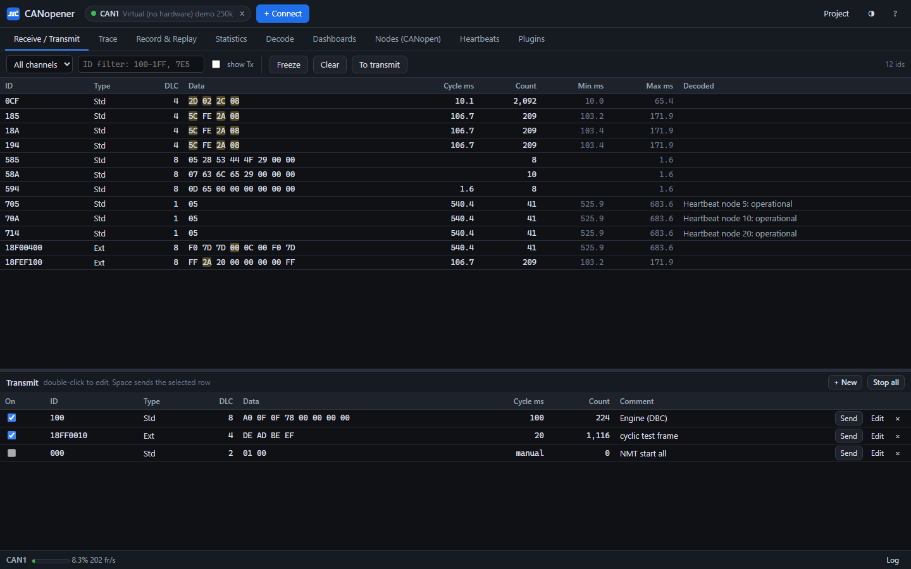

## Contents

1. [Getting started](#getting-started)
2. [Connecting adapters](#connecting-adapters)
3. [The screen](#the-screen)
4. [Selecting, copying and right-click menus](#selecting-copying-and-right-click-menus)
5. [Receive / Transmit](#receive--transmit)
6. [Trace](#trace)
7. [Record & Replay](#record--replay)
8. [Statistics](#statistics)
9. [Nodes (CANopen)](#nodes-canopen)
10. [Decode: DBC, CANopen, J1939](#decode-dbc-canopen-j1939)
11. [EDS editor](#eds-editor)
12. [Sniffer](#sniffer)
13. [Dashboards](#dashboards)
14. [Projects and settings](#projects-and-settings)
15. [Task walkthroughs](#task-walkthroughs)
16. [Claude (MCP)](#claude-mcp)
17. [Plugins](#plugins)
18. [Command line](#command-line)
19. [Files and folders](#files-and-folders)
20. [Troubleshooting](#troubleshooting)
21. [FAQ](#faq)

## Getting started

### Download and start

1. Download `canopener-<version>-win64.zip` from the project's Releases page.
2. Unzip the whole folder somewhere you can write to, for example Documents or the Desktop. Not into
   `Program Files`: CANopener keeps its recordings, logs and settings next to the exe.
3. Double-click `canopener.exe`. The app opens in its own window.

The first time, Windows SmartScreen may say "Windows protected your PC", because the exe is not signed. Click
**More info**, then **Run anyway**.

CANopener runs as a small local server with the window on top. Double-clicking `canopener.exe` again opens a
second window onto the same running CANopener, so both windows show the same bus. There is only ever one
CANopener per PC and port.

The window needs the Microsoft Edge WebView2 runtime, which Windows 10 and 11 usually have. Without it,
CANopener opens in your web browser instead.

### Your first connection

1. Click **+ Connect** in the top bar (or press **Ctrl+K**).
2. Pick your adapter from **Detected adapters**. This fills in the interface and channel.
3. Choose the **Bit rate** of your bus. Tick **Listen-only** if you only want to watch a running machine.
4. Click **Connect**.

The adapter shows as a chip (**CAN1**) in the top bar, and frames start to appear in the receive list. The
status bar at the bottom shows the bus load and frames per second.

### Try it without hardware

1. Click **+ Connect**.
2. Choose the interface **Virtual (no hardware)**.
3. Leave **Start simulated devices on this virtual bus** ticked.
4. Click **Connect**.

The simulator puts these made-up devices on the virtual bus:

| Node | Name | What it does |
|---|---|---|
| 5 | Demo device A (SDO) | Answers SDO, sends heartbeats and a TPDO. Its node id is set with object 0x2100:00 and applied by a store (0x1010:01) plus an NMT reset. Its bit-rate recipe writes 0x2101:00; the simulator accepts it but keeps running (a virtual bus has no bit rate). CANopener has a recipe for it. |
| 10 | Demo device B (SDO, power cycle) | Like A, node id in 0x2110:01, but the new id only takes effect after a power cycle. The simulator cannot be switched off: it applies the stored id at the next NMT reset instead (Decode > CANopen > **Reset**). CANopener has a recipe for it. |
| 20 | Demo LSS device | Changes its node id and bit rate over LSS (CiA 305). |

There is also a fast free-running frame (0x0CF, 100 times a second), J1939 traffic (two ECUs claiming addresses,
DM1 trouble codes from both, one of them by BAM transport protocol every 30 s) and, every minute, an emergency
message from nodes 5 and 10. The
devices really change their node id when you commission them, so you can practise every node workflow safely.

The virtual bus exists only inside CANopener. It is not visible to other programs.

### Closing

Closing the first CANopener window saves the settings, stops every cyclic transmit and a running replay,
finishes a running recording and closes the adapters: nothing keeps sending after CANopener has closed. A second
window (started while CANopener runs) only looks at the same CANopener; it closes when the first one does.

Without the WebView2 runtime CANopener opens in your browser instead; closing the browser does not stop it. Click
**OK** in the "CANopener is running in your browser" message to stop it.

## Connecting adapters

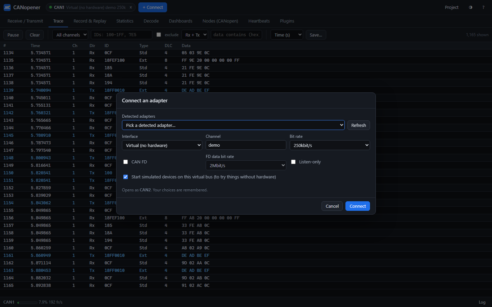

The **Connect an adapter** dialog:

- **Detected adapters** lists what is plugged in right now. Picking an entry fills in the interface and
  channel. **Refresh** searches again (for example after plugging an adapter in).
- **Interface**: the adapter type. Choose it by hand if your adapter is not detected. The line under the
  dialog says what that interface needs (for example a driver).
- **Channel**: the adapter's channel. Leave it empty for the default, shown as the placeholder.
- **Bit rate**: the nominal bit rate, 10 kbit/s to 1 Mbit/s. A rate the adapter's driver cannot do is refused
  with a message that lists the rates it can do. It is never silently replaced by another rate.
- **CAN FD** and **FD data bit rate**: only for interfaces that support CAN FD.
- **Listen-only**: CANopener opens the adapter in its listen-only (silent) mode. See below.
- **Start simulated devices on this virtual bus**: only for the Virtual interface.

The dialog shows which channel the adapter will open as (**CAN1**, **CAN2**, ...). Your choices are remembered
and filled in next time.

### Adapters

**Tested** says whether the adapter has been confirmed working with CANopener on a real bus. The notes say what
CANopener asks each driver for (listen-only, CAN FD); for an untested adapter that is not yet confirmed. If you
use one of them, a report of what works and what does not helps (an issue on the project's GitHub page).

| Adapter | Interface | Channel | Tested | Notes |
|---|---|---|---|---|
| PEAK PCAN-USB | PEAK PCAN-USB | `PCAN_USBBUS1`, `PCAN_USBBUS2`, ... | Not yet | Needs the PEAK driver. Listen-only and CAN FD. |
| Kvaser | Kvaser | `0`, `1`, ... | Yes, receiving and sending (replay) | Needs the Kvaser driver. Listen-only (silent mode) and CAN FD. Tested on a live 250 kbit/s machine bus (classic CAN), with the machine's controller counting frames as an independent check. Receiving: a listen-only recording of about 11 minutes matched the controller's own capture (the same count, 0 differing frames), and bursts of up to 64 back-to-back frames were recorded completely. Sending: replays of 11-bit and 29-bit frames, every 10 ms, all arrived in order with none missing; replays at 500 and 1000 frames/s for a minute arrived without measurable loss. Also a node scan, CANopen decoding, and several hours connected. Not yet tested: the transmit list (single and cyclic frames), CAN FD, other bit rates, and whether listen-only really sends nothing. |
| CANable with slcan firmware | CANable / slcan (COM port) | the COM port, for example `COM5` | Not yet | Listen-only. CAN FD (CANable 2) with a data bit rate of 2 or 5 Mbit/s only. |
| CANable with candleLight firmware | CANable / candleLight (USB) | `0` | Not yet | A USB device; libusb is included. Classic CAN only, no listen-only. |
| Vector | Vector | the driver's global channel index, `0`, `1`, ... | Not yet | Needs the Vector driver library. Listen-only and CAN FD. |
| IXXAT | IXXAT | `0`, `1`, ... | Not yet | Needs the IXXAT VCI driver. CAN FD; no listen-only. |
| ESP32RET, Macchina M2 and other GVRET boards | GVRET (ESP32RET, Macchina M2) | the COM port, for example `COM6`, or `socket://192.168.4.1:23` over WiFi | Not yet | Classic CAN only. Listen-only. USB-UART boards are opened at 1 Mbaud (ESP32RET's default); CANopener holds DTR and RTS low so the board does not reset. Dual-CAN boards: add `@1` to the channel for the second CAN port (`COM6@1`). One port at a time: opening one switches the other off. |
| OBDLink MX, MX+, LX, SX, EX | OBDLink MX/LX/SX/EX (OBD-II) | the COM port, for example `COM7`; OBDLink MX WiFi: `socket://192.168.0.10:35000` | Not yet | Plugs into a vehicle's OBD-II port: high-speed CAN on pins 6 and 14; add `@ms` to the channel for medium-speed CAN on pins 3 and 11 (`COM7@ms`), `@sw` for single-wire CAN on pin 1 (models that have them; the dongle refuses otherwise). Classic CAN only. Listen-only (no CAN ACKs). Receiving runs through a serial or Bluetooth link, so a busy bus can be more than the dongle passes on: it then stops with **BUFFER FULL**, and CANopener restarts it and counts the overrun. Sending is slow: each frame stops receiving, sends, listens 20 ms for answers (so an SDO or LSS reply is caught) and starts receiving again. Other frames during a send are missed, and the receive list pauses for the length of each send, so cyclic sends of more than a few frames per second are not useful. Needs a genuine OBDLink (STN chip); plain ELM327 clones are refused. |
| Linux SocketCAN | Linux SocketCAN | `can0`, ... | Not yet | Linux only (from source). Set the bit rate in the operating system (`ip link`); the bit rate field is disabled. |
| Virtual | Virtual (no hardware) | any name, default `canopener` | Yes (the test suite runs on it) | A bus inside CANopener for trying things and for tests. |

**Two programs on one Kvaser channel.** A Kvaser channel can be open in several programs at once (for example
CANopener and another tool, or the app and `canopener-cli`). Seen on the live-bus test: frames that one program
sends do not appear in the other's receive list or recording. CANopener does show its own sends (marked Tx). To
record what another program on the same adapter sends, or what you replay with the command line while the app is
recording, record on a second adapter or channel.

A CANable runs one of two firmwares: slcan boards normally show up in Device Manager as a COM port, candleLight
boards as a USB device. CANopener has a backend for each.

The **Bit rate** list offers 10, 20, 50, 83.3, 100, 125, 250, 500, 800 and 1000 kbit/s. CANopener refuses a rate
that a backend's driver does not list (slcan has no 800 kbit/s, IXXAT no 83.3 kbit/s) and says so when you
connect. Whether each adapter really runs every rate it accepts has not been tested yet.

**OBDLink over Bluetooth.** Pair the dongle in Windows Bluetooth settings first. Windows then gives it two COM
ports; use the **outgoing** one (More Bluetooth settings > COM Ports, "OBDLink MX ... Outgoing"). The device list
does not show OBDLink dongles: type the COM port as the channel.

### More adapters (help wanted)

We are working on support for more cheap and wireless adapters. None of it is available yet, and nothing here is
a recommendation: we do not have the hardware to test these devices. The plan:

- **slcan over WiFi** (TCP), for devices that speak the same protocol as a CANable, such as WiCAN.
- **ELM327 clones** (not OBDLink) as bus monitors. The Linux kernel's
  [ELM327 driver documentation](https://docs.kernel.org/networking/device_drivers/can/can327.html) notes that a
  busy bus can overflow the chip's buffer ("BUFFER FULL") and that clones do not all implement every feature. We
  have not measured this ourselves.

CANopener is open source, so you can help. If you own one of these devices and can test, or want to write or
improve support for it, open an issue on the project's GitHub page and say which device and firmware you have.
A device joins the table above only after it has been tested.

### Test an adapter on a bench

`tests/hardware/bench_adapters.py` (from source) checks an adapter's row in the table above on a real bus. Put
the adapter under test and a reference adapter that already works on one bench bus, terminated (120 ohm at each
end), with nothing else powered on it. The bench floods the bus, so never run it on a machine.

```
.venv\Scripts\python tests\hardwareench_adapters.py --ref kvaser:0 --dut pcan:PCAN_USBBUS1
```

It checks: the adapter is detected; open and close; every frame kind (both ID lengths, DLC 0 to 8, remote
frames) both ways at 125, 250, 500 and 1000 kbit/s (`--rates all` for every rate in the list); bursts and
seconds of full bus load without a lost, repeated or reordered frame; the transmit list (a single frame, a
10 ms cycle and that it stops); that listen-only really sends no ACK (the reference then repeats its frame);
and CAN FD with `--fd` when both adapters have FD hardware. Use `--note` for firmware and cabling. The report
(markdown and JSON) goes to `bench-results/`; attach it to an issue.

`--ref none` listens on a live bus without a reference (for example an OBDLink in a vehicle): receive
statistics, overruns, close and reopen. It sends nothing, except one OBD-II request with `--obd-request`, which
asks first.

### Listen-only

In listen-only (silent) mode an adapter should send nothing onto the bus, not even the acknowledge bit, so you
can watch a live machine without disturbing it. CANopener asks the driver for this mode; that the adapters
really stay silent has not been confirmed on hardware yet.

On a listen-only channel nothing is transmitted: sending and node changes are refused, cyclic entries stop, a
replay onto it sends nothing (each frame counts as a send error), and a node scan only listens.

A listen-only adapter that is the only other device on the bus sees nothing useful: a frame nobody
acknowledges is repeated by its sender and shows as errors. At least one other node must acknowledge.

### CAN FD

Tick **CAN FD** and choose the **FD data bit rate**. The nominal bit rate stays the arbitration rate. Received
FD frames show as type **FD** (or **FD BRS** with bit rate switching) in the receive list and the trace. To
send FD frames, tick **CAN FD** (and **Bit rate switch** if wanted) in the transmit entry. CAN FD has not yet
been tested with FD hardware.

### Several channels

Click **+ Connect** again to open another adapter, or another channel of the same adapter. Each opens as the
next free channel (CAN2, CAN3, ...) and gets its own chip and its own part of the status bar.

- The receive list shows a **Ch** column as soon as more than one channel is connected; the trace always has
  one. Both have a channel selector. Statistics shows one card per channel.
- A transmit entry has a **Channel**.
- A recording records every channel that is connected when it starts. A channel connected later is not added
  to a running recording.

The **×** on a chip disconnects that channel.

## The screen

- **Top bar**: the CANopener logo; one chip per channel (state dot, name, adapter, channel and bit rate, `FD`
  and `LO` for listen-only; hover a red chip for its error); **+ Connect**; a red **REC** indicator while
  recording; **Project**; the light / dark switch (◑); **?** for the About box.
- **Tabs**: Receive / Transmit, Trace, Record & Replay, Statistics, Decode, Dashboards, Nodes (CANopen), the
  tabs of plugins (the shipped example adds **Heartbeats**), and Plugins.
- **Status bar**: per channel the bus load bar and percentage, frames per second, the bus state when it is not
  ACTIVE (warning, passive, bus off) and the driver reports it, and error counters (error frames / receive errors / send errors). **Log**
  opens the event log; its badge counts new events.

The **event log** lists what happened: connects and disconnects, adapter errors, recordings, node jobs.
Warnings and errors also show briefly as a message in the corner.

The **About** box (**?**) shows the version, the app folder, the MCP address for Claude, how many plugins loaded and
a **User guide** button that opens this guide.

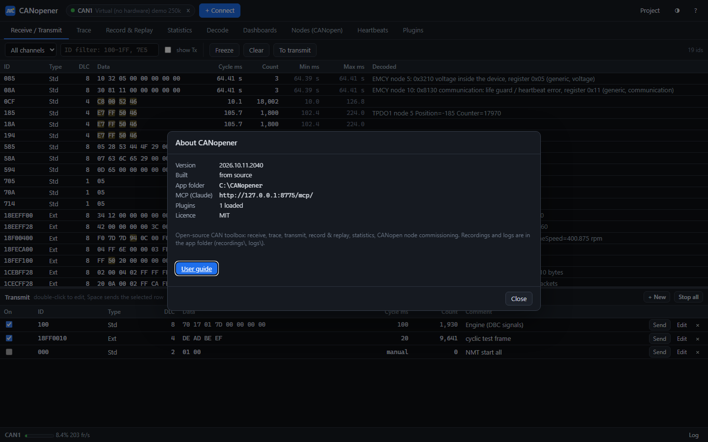

## Selecting, copying and right-click menus

The lists (receive list, transmit list, trace, recordings, busiest IDs, heartbeats) select whole rows. The
selection stays while the list keeps updating, and while you hold the mouse button the receive list, busiest
IDs and heartbeats do not redraw.

| Do this | It does |
|---|---|
| Click a row | Selects it. |
| Shift+click | Selects every row from the last clicked one to this one. |
| Ctrl+click | Adds the row to the selection, or takes it out. |
| Drag over rows with the mouse | Selects the rows you pass. Hold the mouse above or below the list and it scrolls. |
| Ctrl+A | Selects every row shown (click into the list first). |
| Esc | Clears the selection. |
| Ctrl+C | Copies the selected rows as text: a header line, then one line per row, the columns as shown, separated by tabs. |
| Ctrl+V in the transmit list | Pastes frames (see below). |
| Right-click | The menu for the row (it first selects the row if it was not selected). |

In the trace, clicking or right-clicking a row stops the view from following the newest frames, so the rows
stay where they are (**Jump to latest** follows again). The selection works while the trace runs and while it
is paused; rows that drop out of the trace buffer drop out of the selection.

Other text (dialogs, notices, logs, the Decode tables, the statistics cards) can be selected with the mouse as
usual; the Decode tables and the statistics cards do not redraw while you select text in them. Right-click on
selected text offers **Copy**.

What the right-click menus offer:

| Where | Menu |
|---|---|
| Receive list | Copy rows, Copy ID(s), Copy data (hex), Add to transmit list (opens the transmit dialog filled in), Show only this ID in the trace, Hide this ID in the trace, Freeze / Unfreeze view, Select all. |
| Transmit list | Send once, Edit, Duplicate, Start / Stop cyclic (for entries with a cycle time), Delete (several entries: after a question), Copy rows, Paste frames, Select all. On the empty part of the list: New entry, Paste frames, Stop all cyclic. |
| Trace | Copy rows, Copy as .trc lines (PCAN-View .trc 1.1 rows), Copy ID(s), Copy data (hex), Show only this ID, Hide this ID, Clear the ID filter, Add to transmit list, Pause / Resume, Select all. |
| Recordings | Open, Replay, Download, Copy file name, Copy full path, Copy rows. |
| Statistics, Busiest IDs | Copy rows, Copy ID(s), Show only this ID in the trace, Hide this ID in the trace. |
| Nodes, scan result | Set ID, Bit rate, Use in the custom sequence, Copy identity (vendor, product, revision, serial), Copy row, Copy table. |
| Nodes, job log; event log | Copy the whole log. |
| Decode tables | Copy value, Copy row, Copy table; on object dictionary rows also Read from the node (an SDO read, like the Read button). |
| Dashboards, a widget | Copy value (numeric tile, gauge, lamp), Copy signal name(s), Widget settings. |
| Heartbeats | Copy rows, Copy node ID(s), Show only this heartbeat in the trace. |
| A channel chip | Reconnect, Disconnect (or Close for a file), Copy. |
| EDS editor, object tree and sub-index table | Copy index, Copy name, Copy value, Copy as rows, Open in the PDO editor (PDO objects), Add a sub-index, Delete the sub-index or object. |
| EDS editor, problems | Go to the object, Copy problem, Copy all problems. |
| EDS editor, PDO list | Edit, Copy COB-ID, Copy the mapping (the encoded entries), Delete. |
| Sniffer, an id | Details and candidates, Copy ID, Copy data, Copy row, Copy all rows shown, Show only / Hide this ID in the trace, Add to transmit list, Notch. |
| Sniffer, a candidate | Make a quick signal, DBC lines, Copy bit range (DBC notation), Copy value now. |

"Show only" and "Hide" set the trace's ID filter (hiding adds to the IDs already hidden) and empty the trace,
like any filter change.

**Paste frames** into the transmit list: click into the transmit list and press **Ctrl+V**, or use **Paste
frames** in its menu. It reads lines of an ID and data bytes, for example `18FEF100 FF 80 20 00 00 00 00 FF`,
candump lines (`123#1122`, `123#R`, `(1.5) can0 123#1122`), `.trc` rows (versions 1.0, 1.1 and 2.x, as CANopener
records them), or rows copied from the receive list, trace or transmit list. A line whose DLC does not match its
bytes is listed as not understood. A dialog lists the frames
(and the lines it did not understand) and asks for a channel for frames without one; **Add** adds them as manual
entries without a cycle time. Nothing is sent until you click **Send**. If the menu item cannot read the
clipboard (the browser does not allow it), it says so: press **Ctrl+V** in the list instead.

Checked in a browser and in the desktop window: the row selection, Ctrl+C, the right-click menus, the Cut / Copy
/ Paste menu of text fields and **Paste frames** from the menu. Rows copied with Ctrl+C paste into Excel with
the columns in place.

## Receive / Transmit

The main tab, as in PCAN-View: the receive list on top, the transmit list below. Drag the bar between them to
resize.


### Receive list

One row per CAN ID (per channel):

| Column | Meaning |
|---|---|
| Ch | The channel (only with several channels). |
| ID | Hex; 3 digits for 11-bit, 8 digits for 29-bit IDs. `Tx` marks frames CANopener sent. |
| Type | Std, Ext, FD, FD BRS, RTR, Error. |
| DLC | Data length. |
| Data | The last data. Bytes that changed in the last 1.5 s are highlighted. |
| Cycle ms | The last interval between two frames of this ID. |
| Count | Frames received. |
| Min ms / Max ms | The shortest and longest interval seen. |
| Decoded | The decoded content, as soon as a decoder knows this ID (DBC, CANopen EDS, heartbeats, EMCY, J1939). |

- Click **ID**, **DLC**, **Cycle ms** or **Count** in the header to sort; click again to reverse.
- **ID filter** takes hex IDs and ranges, separated by commas: `100-1FF, 7E5`.
- The channel selector shows **All channels** or one.
- **show Tx** adds rows for frames CANopener itself sent.
- **Freeze** stops the view from updating (the button then says **Frozen**). Traffic keeps being counted.
- **Clear** resets the rows and counters of the selected channel (or of all channels).
- **To transmit** copies the selected row into a new transmit entry, with its data, flags and cycle time. A
  double-click on a row does the same.

### Transmit list

| Column | Meaning |
|---|---|
| On | Starts or stops a cyclic entry. Disabled for an entry without a cycle time. |
| ID, Type, DLC, Data | The frame. |
| Cycle ms | The cycle time, or `manual`. |
| Count | Frames sent. |
| Comment | Your note. An **error** badge shows if sending failed (hover it for the reason). |

- **+ New** adds an entry. **Stop all** stops every cyclic entry.
- **Send** sends the entry once. Or click a row to select it and press **Space**.
- **Edit** (or a double-click on the row) changes it. **×** deletes it.

The transmit dialog:

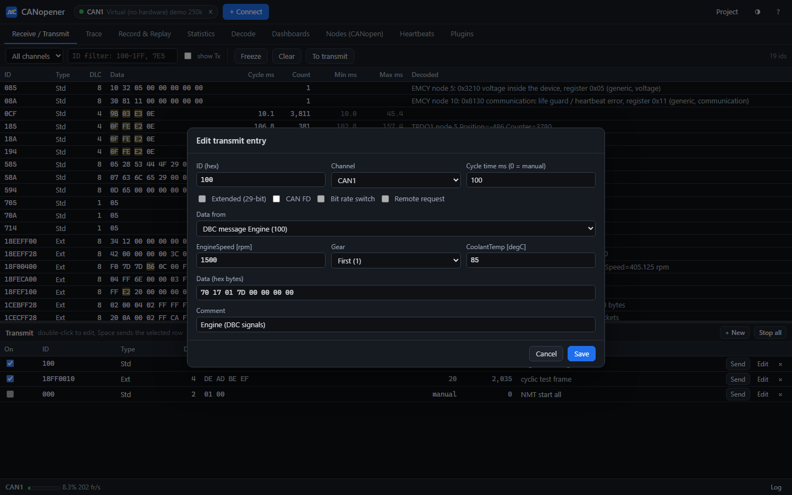

- **ID (hex)**, **Channel**, **Cycle time ms (0 = manual)**; a cyclic entry needs at least 1 ms.
- **Extended (29-bit)**, **CAN FD**, **Bit rate switch** (FD only), **Remote request** (then a **Remote request
  DLC** field appears).
- **Data from**: appears once a DBC file is loaded (see [Decode](#decode-dbc-canopen-j1939)). Choose **raw
  bytes** to type the data yourself, or a **DBC message** to type signal values: one field per signal, with a
  list for signals that have named values. The ID and data fields are then not used: when you click **Add**
  (or **Save**), CANopener encodes the bytes with the DBC and the transmit row shows them.
- **Data (hex bytes)**: for example `11 22 33 44`.
- **Comment**.

The transmit list is saved automatically. After a restart the entries are back, but cyclic entries never start
by themselves: tick **On** again.

## Trace

Every frame in time order, received and sent, from all channels. The view scrolls with the newest frames;
scroll up to look at older ones (a **Jump to latest** button brings you back).

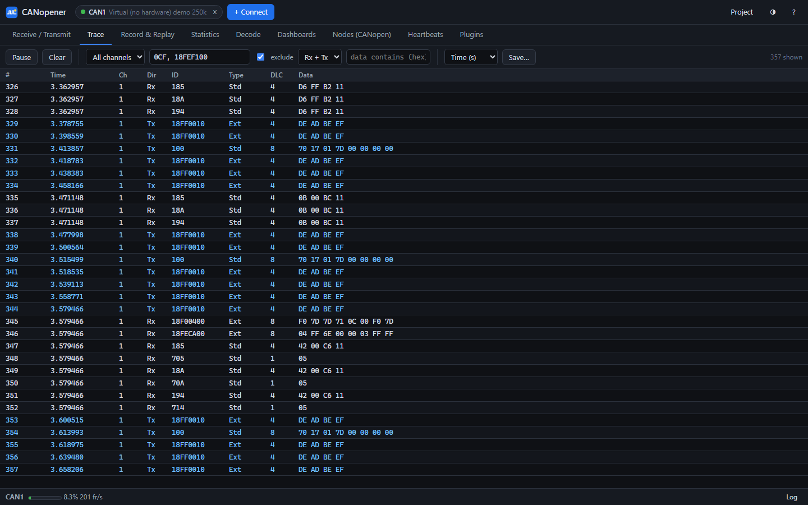

- **Pause** stops the live view (**Paused - resume** continues). Recording and counters keep running. A
  `paused` row marks the gap.
- **Clear** empties the view.
- **Filter**:
  - the channel selector;
  - **IDs**: hex IDs and ranges, `100-1FF, 7E5`; tick **exclude** to hide these IDs instead of showing only
    them;
  - **Rx + Tx**, **Rx only** or **Tx only**;
  - **data contains (hex)**: frames whose data contains these bytes, for example `2F 00 21`.

  The filter runs in the server, before the frames are sent to the window, so a rare ID is never lost among
  thousands of others.
- **Time**: **Time (s)** since the first frame shown, **Delta (ms)** to the previous frame shown, or **Clock**
  (wall-clock time).
- **Save...** writes everything the trace buffer holds to a file in the recordings folder: all channels,
  without the filter, about the last 260 000 frames per channel. Formats `.trc`, `.asc`, `.blf`, `.log` and
  `.csv`; the name is automatic unless you give one.

The info line on the right says how many frames are shown. The live view shows up to 25 000 frames per second.
If more arrive, it says how many were not shown live; they are still in the buffer, in a save and in any
recording. Use **Record** for long captures.

## Record & Replay

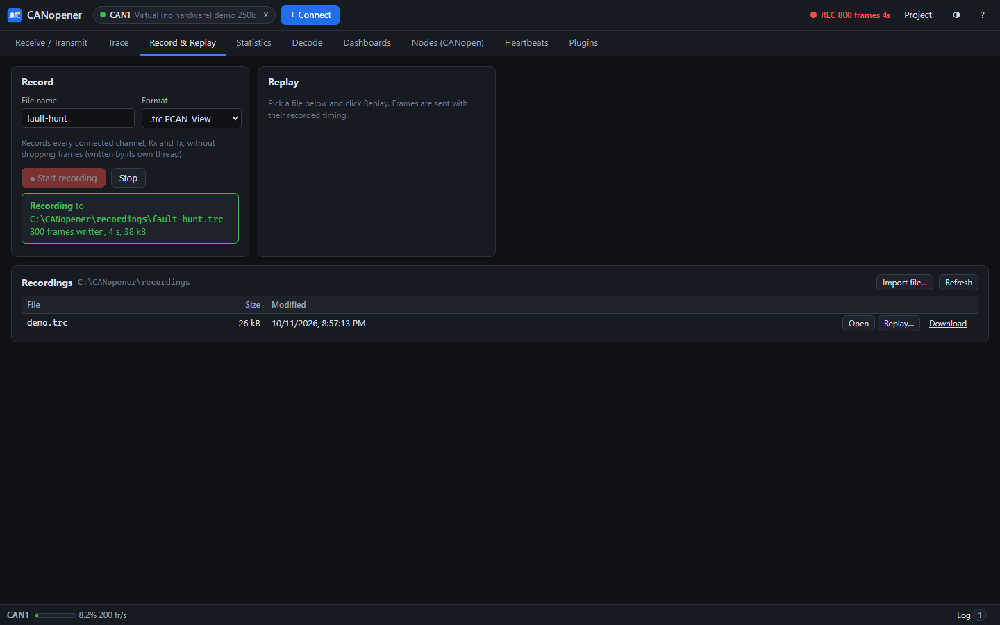

### Record

1. Optionally type a **File name** (default: the date and time).
2. Choose the **Format**.
3. Click **Start recording**.

Every channel connected when the recording starts is recorded, received and sent frames, by a writer thread of its own. In the tests it
recorded every frame at more than 8 000 frames per second on the virtual bus (about a full 1 Mbit/s bus); it has
not yet been measured on a real bus. The card shows the file, the frames written, the duration and the size; the top bar
shows **REC**. **Stop** finishes the file.

An existing file is never overwritten: `-1`, `-2` ... is added to the name instead.

The formats are written to their published layouts and read back by CANopener in the tests; opening the files
in PCAN-View, Vector tools or candump has not been tried yet.

| Format | Use |
|---|---|
| `.trc` | PCAN-View trace (version 2.1: CAN FD, Rx/Tx, several buses). |
| `.blf` | Vector binary logging format (CANalyzer, CANoe, ...). |
| `.asc` | Vector ASCII. |
| `.log` | Linux candump. |
| `.csv` | Spreadsheets. |
| `.canbin` | A compact binary format for loggers on a PLC (classic CAN). |

### Recordings

The **Recordings** card lists the files in the recordings folder (its path is shown next to the title), newest
first:

- **Open** loads the file for offline viewing (see below).
- **Replay...** sends it onto a bus.
- **Download** saves a copy where you choose.
- **Import file...** copies a `.trc`, `.asc`, `.blf`, `.log`, `.csv` or `.canbin` file from elsewhere into the
  recordings folder. **Refresh** reads the folder again.

### Open a recording offline

**Open** loads the file as a *file channel*: it shows as a chip named after the file, with the word `file`.

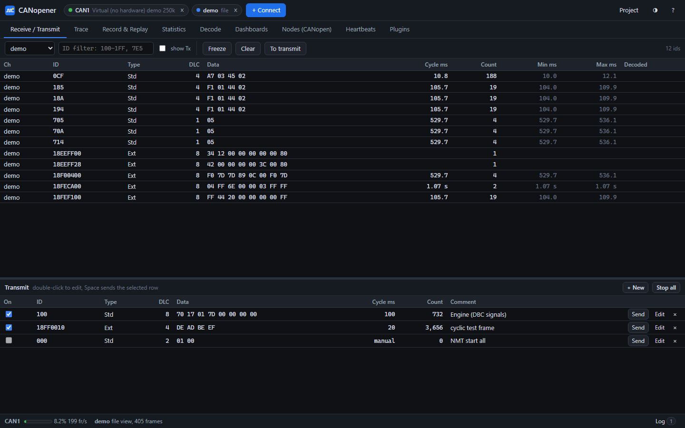

- The receive list shows its IDs with the real cycle times from the recorded timestamps (pick the file in the
  channel selector to see only it).
- The trace shows its frames, from the start.
- The status bar shows how many frames it holds.

A file channel never transmits and needs no adapter. Close it with the **×** on its chip.

### Replay

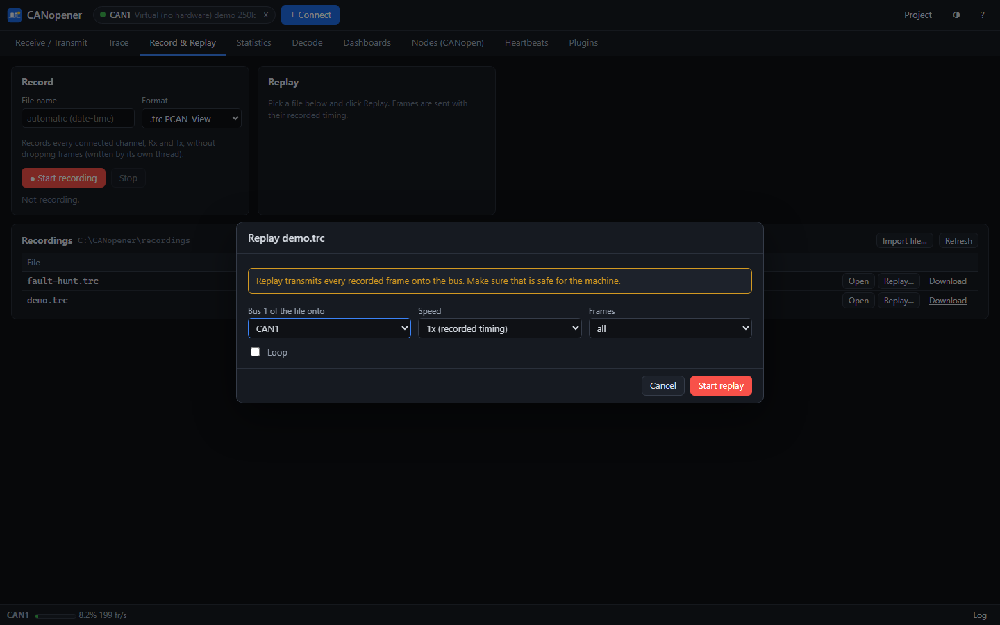

**Replay...** asks:

- **Bus 1 of the file onto**: the connected channel to send on;
- **Speed**: 0.5x, 1x (recorded timing), 2x or 10x;
- **Frames**: all, recorded Rx only, or recorded Tx only;
- **Loop**: start over at the end, one typical frame gap after the last frame. A file whose pass would take
  under 10 ms at the chosen speed is not looped (it would send its frames back to back).

Replay transmits every recorded frame onto the bus. Make sure that is safe for the machine. The Replay card
shows the progress, with **Pause** / **Resume** and **Stop**.

On a real bus, replay has been tested with a Kvaser at 250 kbit/s, from the command line (see
[Adapters](#adapters)).

## Statistics

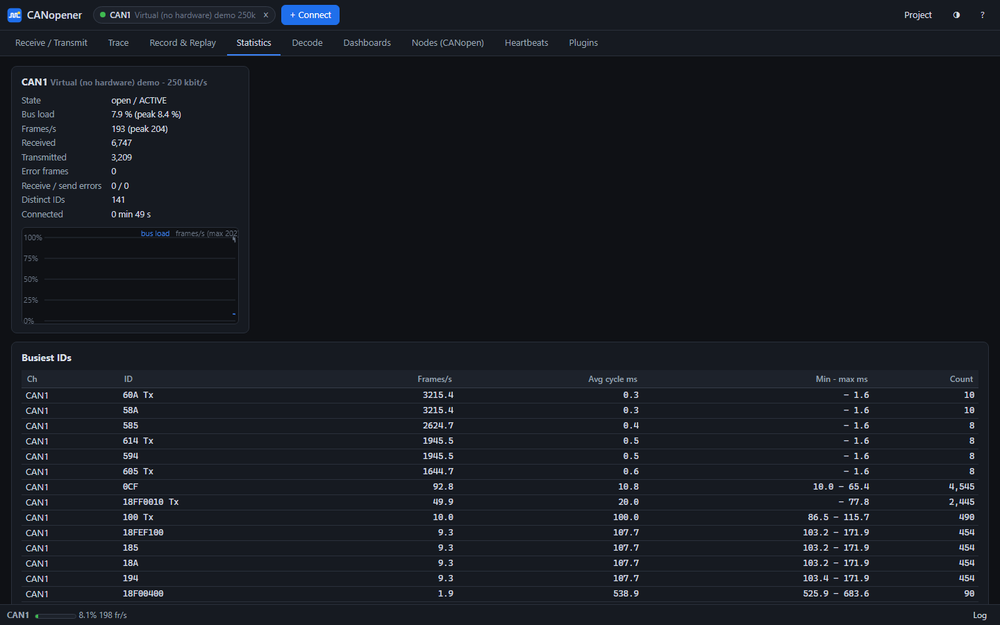

One card per channel:

- **State**: open, error or file, and the bus state (ACTIVE, warning, passive, bus off).
- **Bus load**: now and peak, estimated from the frames.
- **Frames/s**: now and peak.
- **Received**, **Transmitted**.
- **Error frames** (and per second), **Receive / send errors**, adapter overruns, as far as the driver reports
  them.
- **Distinct IDs**, and how long the channel has been **Connected**.

The chart shows bus load and frame rate over the last 10 minutes.

**Busiest IDs** ranks the periodic IDs by their average rate over the whole time they were seen: frames per
second, average cycle, minimum and maximum interval, count. IDs seen fewer than 5 times (single SDO
transfers, NMT commands) are left out.

## Nodes (CANopen)

This tab finds the CANopen nodes on a channel and changes their node ID or bit rate. Every change is a *plan*:
you first see every frame that will be sent, tick a box, and only then is anything sent. Every scan, plan and
run from this tab is written to `logs\nodes.log` (scans from the command line are not logged; their plans and
runs are).

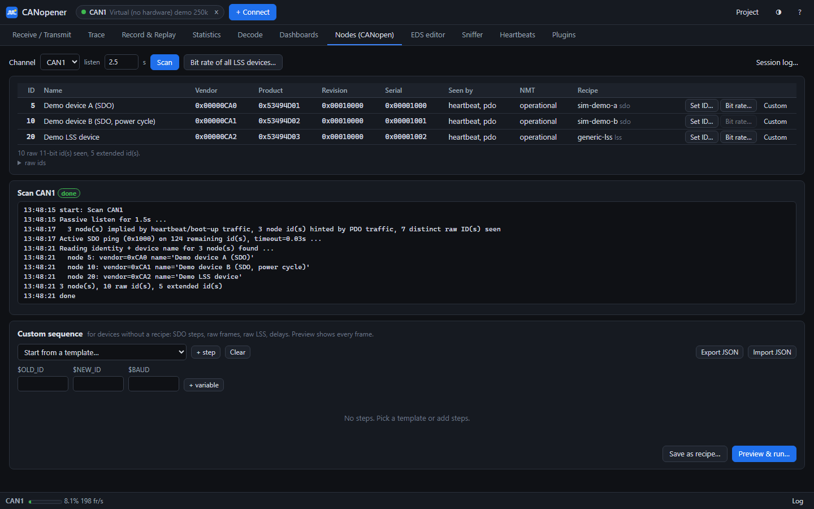

### Scan

Choose the **Channel**, the **listen** time (default 2.5 s) and click **Scan**.

1. CANopener listens: heartbeats, boot-ups and PDOs hint at node ids.
2. It pings every node id it has not already seen (heartbeat, boot-up) with an SDO read of 0x1000 (device
   type).
3. For each node found it reads the identity (0x1018: vendor id, product code, revision, serial number) and
   the device name (0x1008).

The table shows each node with its name, identity, how it was seen (heartbeat, pdo, sdo), its NMT state, and
the **recipe** CANopener will use to change its node ID and bit rate. Below the table: how many raw 11-bit
and extended IDs were seen, and PDO-range traffic that has no CANopen node behind it. **raw ids** lists them
all.

The scan only reads: it changes nothing on any node. On a listen-only channel it only listens: it lists the
nodes it hears heartbeating and reads no identity. PDO-range traffic is then shown as "not asked", because a
node without a heartbeat, or a node whose PDOs use other CAN ids, cannot be told apart from free-form traffic
without asking. The job log
under the table shows each step; **Stop** cancels a running job before its next step. A bit-rate change
ignores **Stop** after the node reset or LSS activate, until the adapter has reopened at the new rate. When a
job stops or fails after it wrote something, the message lists what was already sent: a stored value can still
take effect at the device's next reset or power cycle. **Session log...** shows the end of
`logs\nodes.log`.

### Recipes

A recipe says how a device changes its node ID (and bit rate). CANopener picks it by the vendor id from 0x1018
(and the product code, when a recipe names one):

- **LSS** (CiA 305) is the default for every device without a recipe;
- **SDO recipes** write the device's own node-id object, store, and reset;
- **read-only** devices cannot be changed (**Set ID...** is disabled).

CANopener ships no recipes for real devices, only those of the simulator's demo devices. For your devices,
build the sequence in the [custom mode](#custom-mode-for-unknown-devices) and **Save as recipe**. From then on
**Set ID...** and **Bit rate...** use it automatically. A saved recipe applies to every product of that
vendor, and the preview says so.

### Set ID

**Set ID...** on a node row asks for:

- **New node ID (1..127)**;
- **Method**: automatic (by vendor id), LSS, or a named recipe (the preview warns when the recipe was written for
  another vendor or product than the device reports);
- **Verify timeout s**: how long to wait for the node to answer at its new id.

**Preview** then shows the plan:

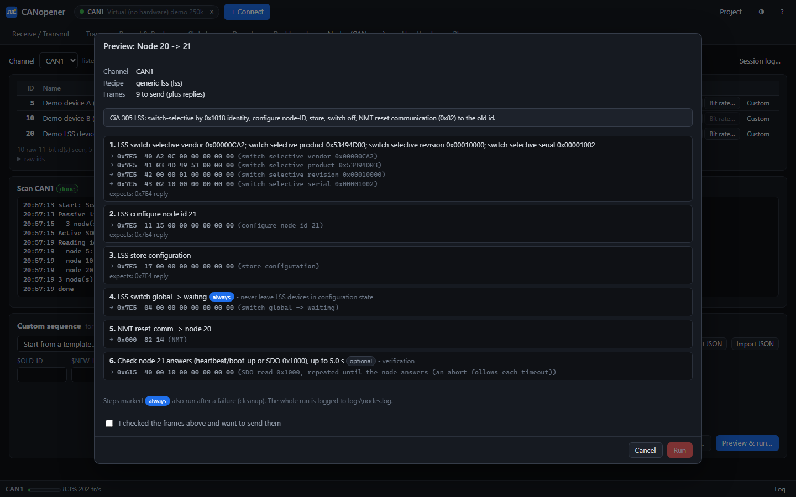

- the channel, the recipe and where it comes from, the number of frames;
- warnings: a **conflict** when the new id's COB-IDs (heartbeat, SDO, PDOs) are already used by any ID seen on
  the bus, not only by other CANopen nodes; that a power cycle is needed;
- every step with the **exact frames** that will be sent, including the conditional ones (the SDO abort after
  a timeout, the polls of the new id), and the reply each step expects.

A new id that the scan found in use by another node is refused, not only warned about.

For a device with a vendor or sequence recipe, the first steps read its identity (0x1018 vendor, product, serial)
at the old id. If another device now sits there (a swapped module, or another machine since the scan), the run
stops before anything is written. The check at the new id also reads 0x1018. Only an answer from the device that
was moved counts as verified, not any device that happens to answer at that id. The check compares what the scan
read: the product only if the scan read one, the serial number only if it is not 0. Two devices of the same model
that report no serial number cannot be told apart this way. A failed check at the new id is reported as "could
not verify", not as an error.

Steps marked **always** also run after a failure (cleanup, for example LSS back to waiting). Steps marked
**optional** only warn when they fail.

Nothing is sent until you tick **I checked the frames above and want to send them** and click **Run**. The run
shows live in the job log, the result shows under it (verified at the new id, or "power cycle required"), and
the whole run is appended to `logs\nodes.log`.

A scan is needed first: the conflict check and the recipe come from it. Reconnecting the adapter makes the last
scan stale; scan again.

### Bit rate

**Bit rate...** on a node row changes that node's bit rate with its recipe (SDO or LSS). **Bit rate of all LSS
devices...** switches every LSS device on the bus at once. The dialog asks for:

- **New bit rate** (10 to 1000 kbit/s);
- **LSS switch delay ms**;
- **Verify timeout s**.

The preview shows the frames as for Set ID. An SDO or sequence recipe first reads the node's identity (0x1018),
as Set ID does, and stops before writing if another device answers. The sequence is configure, store, then
activate. After the switch
the adapter reopens at the new rate and waits for traffic. Nodes that did not switch stay at the old rate and
are no longer heard; the preview warns about this. Bit-rate changes have been tested on the simulator only, not
yet on a real device.

The button is disabled for a node whose recipe has no bit-rate method (use the custom mode).

### Custom mode for unknown devices

The **Custom sequence** card builds your own steps, for devices without a recipe, or for anything else you
want to send as a checked, logged sequence.

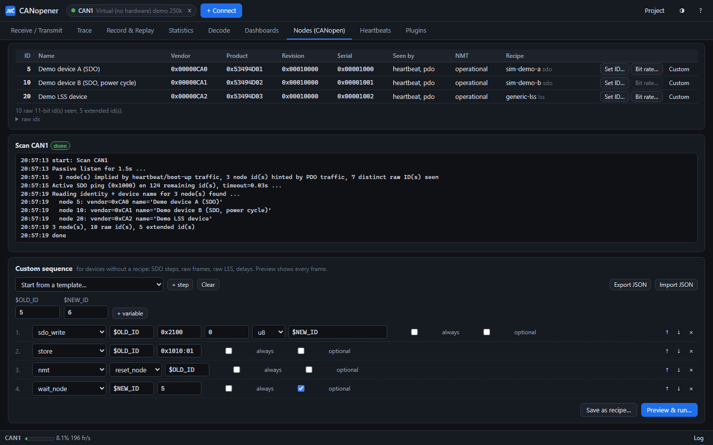

- **Start from a template...** loads a starting point: SDO node id + store + reset; LSS node id for the only
  device on the bus; LSS bit rate of every LSS device; read identity and name; NMT start all; NMT all to
  pre-operational.
- **+ step** adds a step; the arrows move it, **×** removes it; **Clear** removes all.
- **Variables** (`$OLD_ID`, `$NEW_ID`, `$BAUD`, ...) are filled in above the steps. **+ variable** adds your
  own.
- **Custom** on a scanned node row puts its id into `$OLD_ID` and its identity into `$VENDOR`, `$PRODUCT`,
  `$REVISION`, `$SERIAL`.
- **Preview & run...** shows the same exact-frame preview as Set ID.
- **Save as recipe...** stores the sequence as the recipe for a vendor id (see the walkthrough
  [Commission an unknown device](#commission-an-unknown-device-and-save-a-recipe)).
- **Export JSON** / **Import JSON** share sequences as files.

The editor keeps your steps between sessions.

| Step | What it sends |
|---|---|
| `sdo_write` | SDO download: node, index, sub, type (u8, u16, u32, i8, i16, i32, u64, i64, f32, str, bytes), value. |
| `sdo_read` | SDO upload; with an **expect** value the step fails when the device answers something else. |
| `store` | Writes 'save' to 0x1010 (sub 1 by default). |
| `nmt` | start, stop, preop, reset_node, reset_comm, to one node or all (0). |
| `raw` | Any frame: id, data, 29-bit (ext), FD. |
| `lss` | switch_global (waiting / configuration), switch_selective (vendor, product, revision, serial), configure_node_id, configure_bit_timing, activate_bit_timing, store, inquire_node_id. |
| `delay` | A pause in ms. |
| `reopen` | Reopens the adapter at another bit rate (kbit/s). |
| `wait_node` | Checks that a node answers (heartbeat, boot-up or SDO), with a timeout. |
| `wait_traffic` | Checks that any frame arrives, with a timeout. |

Placeholders: `$OLD_ID`, `$NEW_ID`, `$BAUD` (kbit/s), `$VENDOR`, `$PRODUCT`, `$REVISION`, `$SERIAL`, and your
own variables. Per step, **always** runs it also after a failure, **optional** makes a failure only a warning.

## Decode: DBC, CANopen, J1939

The **Decode** tab has three views, **DBC**, **CANopen** and **J1939**. Decoded values appear:

- in the receive list's **Decoded** column;
- on this tab;
- as signals for [dashboards](#dashboards) and for Claude.

The decoder setup (DBC files, EDS per node, extra SDO servers, J1939 channels) is saved with the settings and in
projects.

### DBC

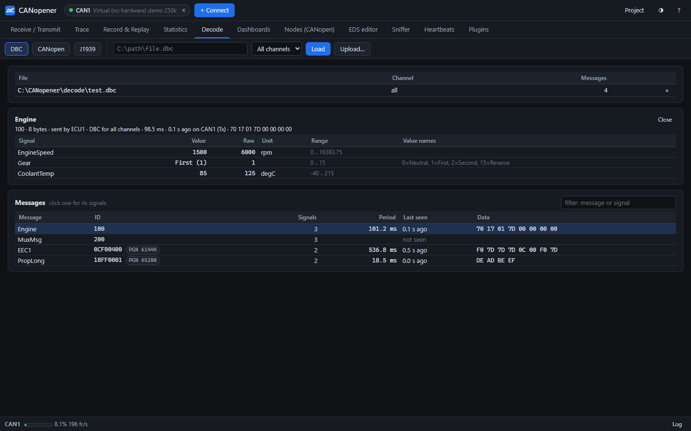

- Give the full path of a `.dbc` file and click **Load**, or **Upload...** one. Choose **All channels** or one
  channel. Several files can be loaded; **×** unloads one.
- The **Messages** table lists every message of the loaded files: ID (and PGN for J1939 messages), number of
  signals, and from the bus its period, when it was last seen (**stopped** when no frame came for more than 3
  periods) and the data of the last frame. Type into the filter to find a message, or a message by one of its
  signals.
- Click a message for its signals, live: value (with its named value), raw value, unit, range and the named
  values. Click it again, or **Close**, to close it.
- Multiplexed messages decode (the multiplexer and the signals of the active multiplexer value); the other
  multiplexed signals have no value until a frame carries them.
- J1939 messages of a DBC (frame format J1939PG) match by PGN on channels with J1939 on, so every source
  address decodes. The message shows the last frame of any source address; the **J1939** view shows each source
  address on its own.

With a DBC loaded, the transmit dialog has the **DBC message** mode: see
[Decode with a DBC and transmit by signal value](#decode-with-a-dbc-and-transmit-by-signal-value).

### CANopen

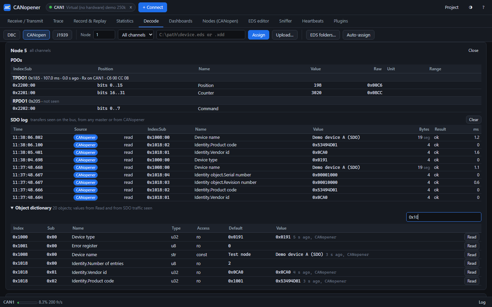

- Set the **Node** id, the channel, and give the path of an `.eds`, `.dcf` or `.xdd` file: **Assign**, or
  **Upload...**.
- **EDS folders...** sets the folders with your EDS / DCF / XDD files (subfolders too). It is an app setting,
  not part of a project. In the app window **Browse...** opens a folder picker; in a browser, type or paste the
  path.
- Right-click a node row (here, or on the **Nodes** tab after a scan) and choose **Assign EDS file...**. The
  dialog shows the node's vendor id, product code and revision, from the last scan or read from the node over
  SDO (object 0x1018, reads only). It lists the files of the EDS folders, the ones that fit the node first:
  **vendor + product + revision**, then **vendor + product**, then **vendor only**. Pick one, or give any other
  file by path, **Browse...** or **Upload...**.
- **Auto-assign** does this for every node without a file, nodes seen by heartbeat or by the last scan. A file
  is assigned only when it is clear which one: one file fits the vendor id and product code, or one of them
  also fits the revision. Copies of the same file count once. When several different files fit, or only the
  vendor id fits, the node is left for you to pick in its **Assign EDS file...** dialog. Nodes that already
  have a file keep it.
- The node table lists the nodes with a file, the nodes seen sending heartbeats (marked "no EDS") and the nodes
  with an extra SDO server, their PDOs and their NMT state from the heartbeats.
- PDOs decode from the file's mapping. **Read PDO mapping** reads the device's real mapping over SDO (uploads
  only) and decodes with that instead (marked **from device**).
- Click a node row for its panel below the table (click it again, or **Close**, to close it). It shows:
  - **PDOs**: each TPDO and RPDO with its COB-ID, period, when it was last seen (**stopped** when no frame came
    for more than 3 periods), Rx or Tx and the data of the last frame; under it every mapped object with its
    index:sub, its bits in the frame, name, value (with its named value from the file), raw value, unit and
    range. The values update twice a second.
  - **SDO log**: the SDO transfers with the node seen on the bus, newest first. **Source** says who asked:
    **bus** (another master, a PLC, another tool) or **CANopener** (Read, sequences, Claude). Expedited and
    segmented reads and writes are reassembled and decoded with the file (without a file: the CiA 301 names
    of 0x1000-0x1FFF and the bytes). An object that is a single variable in the file has its name on sub 0
    only; other subs of it show as unknown (index:sub) with their bytes. Aborts show the abort code and its meaning; block transfers are listed
    but not decoded. **Clear** empties it.
  - **Object dictionary** (click to open): index, sub, name, type, access, default, and the value: the last
    value read or seen in SDO traffic, with how long ago and from whom. **Read** reads one object from the
    device. **Write...** asks for a value and opens the exact-frame preview. The filter finds objects by name or
    index.
- A node without a file (seen by heartbeat) has a panel too: the frames on the predefined PDO ids (TPDO
  0x180/0x280/0x380/0x480 and RPDO 0x200/0x300/0x400/0x500 + node id), not decoded, and its SDO log.
- SDO traffic is only followed for nodes with a file or a heartbeat, and for transfers CANopener starts, as
  other protocols can use the same IDs.
- **SDO servers...** adds extra SDO servers. A node can have a second SDO server (0x1201...) that another tool
  talks to on other COB-IDs, for example request 0x627 and response 0x5A7 for node 7. Those ids look like the
  default SDO ids of node 39, so they are not followed by themselves. Give the node, the channel (or all) and the
  request and response COB-ID (hex), then **Add**. Its transfers then show in that node's SDO log, decoded with
  its file, with the pair next to read/write. The list is saved with the settings and in projects. Nothing is
  sent; **&times;** removes a pair.
- When only the reply of a transfer is seen, it is logged as far as the reply tells: an expedited read with its
  value, a write as **request not seen** (written, value unknown). This happens with two programs on one Kvaser
  channel (see [Adapters](#adapters)): CANopener sees the replies but not the other program's requests.
- **Start**, **Stop**, **Pre-op** and **Reset** send NMT commands to the node, after the same preview.
- The **EMCY log** decodes emergency messages: the error code with its meaning, the error register bits and the
  vendor-specific bytes. **Clear** empties it (and the J1939 transport-protocol list).

Every write (SDO write, NMT) is a plan, as on the Nodes tab: nothing is sent before you have seen the frames
and confirmed.

### J1939

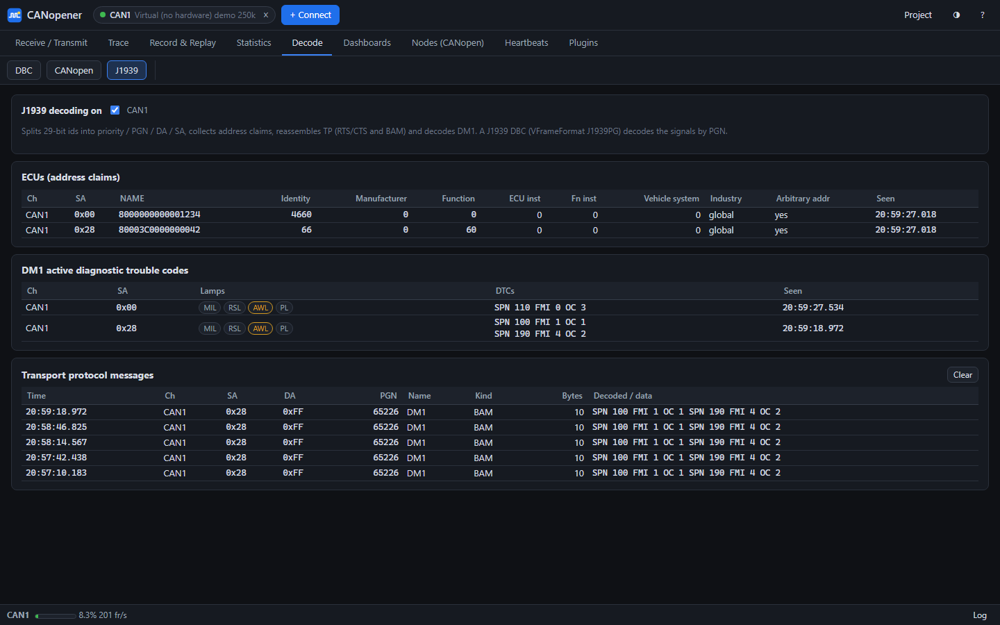

Tick **J1939 decoding on** for each channel that carries J1939. Then:

- 29-bit IDs split into priority, PGN, destination and source address; the receive list's Decoded column shows
  the PGN name and addresses.
- **ECUs (source addresses)** lists every source address seen on the J1939 channels: how many frames, when
  the last came, and its address claim with the NAME decoded (identity number, manufacturer code, function, ECU
  and function instance, vehicle system, industry group, arbitrary address capability), or "no address claim
  seen".
- Click a source address for the PGNs it sends: name, priority, destination, period, last seen and the last
  frame's data, decoded when a J1939 DBC covers the PGN; and its reassembled transport-protocol messages.
- **DM1 active diagnostic trouble codes** shows the lamps (MIL, RSL, AWL, PL; lit when on) and the active DTCs
  (SPN, FMI, occurrence count) per ECU.
- **Transport protocol messages** lists messages longer than 8 bytes, reassembled from RTS/CTS and BAM
  transfers (and aborted ones with the reason), with the decoded content.

### Signal names

| Source | Signal key |
|---|---|
| DBC | `dbc/<Message>/<Signal>` |
| DBC, J1939 message | `j1939/<SA>/<PGN>.<Signal>` |
| CANopen PDO | `canopen/<node>/<PDO>.<variable>`, for example `canopen/5/TPDO1.Position` |
| CANopen NMT state, EMCY | `canopen/<node>/NMT`, `canopen/<node>/EMCY.code`, `canopen/<node>/EMCY.register` |
| J1939 DM1 | `j1939/<SA>/DM1.ActiveDTCs` (number of active DTCs) |
| Quick signal | `raw/<name>` |

## EDS editor

The **EDS editor** tab creates, opens, checks and saves CANopen device descriptions: EDS files, and DCF files
(an EDS plus the values for one node). It also compares a file with a node on the bus, and builds an EDS for a
device that came without one. It comes as a plugin and is part of the release.

Everything that talks to a node (compare, read PDOs, create from a node, write a DCF) has been tested against
the simulator and other CANopen SDO servers on the virtual bus, not yet against a real device.

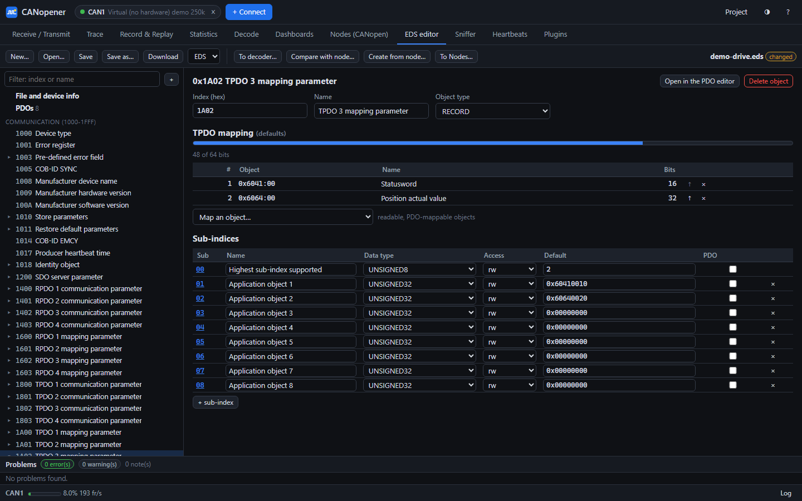

**Toolbar:**

| Button | Does |
|---|---|
| **New** | Starts from a template: a CiA 301 device (the communication objects, 4 RPDOs and 4 TPDOs), CiA 401 generic I/O, or a CiA 402 drive, with the usual default PDO mapping. Type the vendor and product. |
| **Open** | Opens an EDS, DCF or XDD/XDC file: from the list (the `eds` and `decode` folders next to `canopener.exe`), by path, or by upload. XDD files are saved as EDS. |
| **Save**, **Save as** | Saves into the `eds` folder next to `canopener.exe`, as EDS or DCF. |
| **Download** | A copy to keep somewhere else. |
| **EDS / DCF** | DCF shows the value fields (ParameterValue) and the commissioning section (node id, bit rate). |
| **To decoder** | Saves the file and assigns it to a node in **Decode > CANopen**. |
| **Compare with node** | Reads the node (see below). |
| **Create from node** | Builds an EDS from what a node answers (see below). |
| **To Nodes** | Turns the DCF values into steps in the Nodes tab (see below). |

**Editing.** The tree on the left groups the objects: communication (1000-1FFF), manufacturer (2000-5FFF),
device profile (6000-9FFF). Type in the filter to find an index or a name. Click an object to edit it on the
right: index, name, object type (VAR, ARRAY, RECORD), data type, access, default value, limits and whether it can
be mapped into a PDO. For an ARRAY or RECORD the sub-indices are a table; **+ sub-index** adds one and keeps
sub-index 0 (the highest sub-index) right. **+** next to the filter adds an object. **File and device info** at
the top of the tree holds the file and device data, the bit rates and the comments.

Values are typed as in the file: `0`, `0x1F`, `010` (octal, as CiA 306 says), or `$NODEID+0x180` for values that
depend on the node id.

**PDO mappings.** A mapping object (1600-17FF for RPDOs, 1A00-1BFF for TPDOs) shows its entries and the bits
used, and **Open in the PDO editor** takes you to the PDO editor below.

**Problems.** The list at the bottom is checked after every change. Click a problem to go to the object. It
finds, among others:

- missing mandatory objects (1000, 1001, 1018), unknown data types and access types;
- values that are not valid for their data type or are outside their limits;
- a sub-index 0 that does not match the sub-indices;
- PDO mappings longer than 64 bits, mapped objects that do not exist, are not PDO-mappable, have another size,
  or have the wrong access (an RPDO needs a writable object);
- two PDOs with the same COB-ID;
- DeviceInfo numbers that differ from the identity object (1018).

**What is kept.** Keys and sections the editor does not know (vendor tool settings, `ObjFlags` and so on) are
written back unchanged, so fixing one value in a vendor's EDS does not lose the rest. Objects written in the
compact form (`CompactSubObj`) are written out as normal sub-indices.

### PDO editor

**PDOs** at the top of the tree lists every RPDO and TPDO of the file, decoded: COB-ID, on or off, transmission
type, bits mapped and the mapped objects. Click one to edit it. In a DCF the editor shows and changes the DCF
values; in an EDS, the defaults.

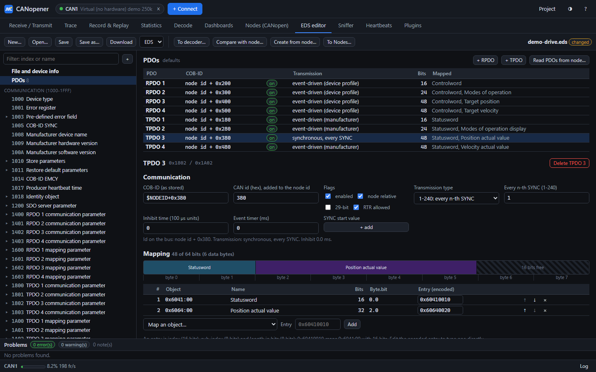

**Communication** (object 1400+ for RPDOs, 1800+ for TPDOs):

- **COB-ID** as stored, for example `$NODEID+0x180`, and decoded: the CAN id, and the flags **enabled** (bit 31
  clear), **node relative** (the CAN id is added to the node id), **29-bit** (bit 29) and **RTR allowed** (bit 30
  clear). Change either side: the flags rewrite the stored value, and a typed value updates the flags. With a node
  id in the DCF commissioning section, the id on the bus is shown for that node, and **node relative** rewrites
  the same id with or without the node id (without a node id it asks you to type the COB-ID). An 11-bit id stops
  at 7FF; tick **29-bit** for longer ones. A PDO with CAN id 0 cannot be enabled.
- **Transmission type** in words: 0 synchronous acyclic, 1-240 every n-th SYNC, 252/253 RTR only (TPDOs),
  254/255 event-driven.
- For TPDOs **inhibit time** (in 100 µs units, also shown in ms) and **SYNC start value**; for both the **event
  timer** (ms; for an RPDO the deadline). A parameter the object does not have shows **+ add**: adding it changes
  the device description (the file then says the device has it), so the editor asks first.

**Mapping** (object 1600+ / 1A00+): the frame layout shows which bits of the 8 data bytes each mapped object
fills, and the free bits. Each entry is listed decoded (object, name, bits, byte.bit where it starts) and encoded,
as stored in the object dictionary: index (16 bits), sub-index (8) and length in bits (8), so `0x60410010` maps
0x6041:00 with 16 bits.

- **Map an object** lists the PDO-mappable objects with the right access (readable for a TPDO, writable for an
  RPDO).
- **Gap (dummy)**, for RPDOs, leaves bits unused (dummy objects 0001-0007); the file's `[DummyUsage]` is set to
  allow it.
- Type an encoded entry (**Entry**, or edit one in the list) to map something directly; the list decodes it.
- ↑ ↓ reorder, × removes. The editor keeps the entries and the count (sub-index 0) in step.

**+ RPDO** and **+ TPDO** add the next free PDO (communication and mapping object). PDOs 1-4 get the predefined
COB-IDs (`$NODEID+0x180` and so on); later ones start disabled until you give them a COB-ID. **Delete** removes
both objects. **Read PDOs from node** reads the PDO objects that are in the file from a node (SDO reads only)
and offers to store what the node has as DCF values or defaults, so you see the mapping the node really uses. To
find PDOs the file does not have, use **Create from node** with the range `1400-1BFF`.

The problem list also catches CAN ids that CiA 301 keeps for other services (NMT, SYNC, EMCY, TIME, SDO,
heartbeat, LSS) and ids above 7FF for some node id.

### Compare with a node, read its values

**Compare with node** reads every readable object of the file from a node and lists, per object, the file's
value, the node's value and the status: same, differs, missing (the node does not have it), size (the node sends
another length), read (the file has no value to compare with) or error. Untick **only differences** to see
everything. Objects that change by themselves (status words, actual values, the serial number 0x1018:04) differ
even on a well configured node. When the node stops answering or you press **Stop**, what was read so far is
kept.

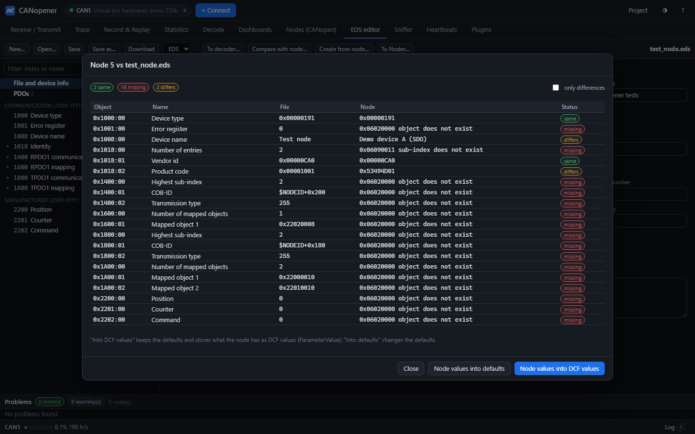

- **Node values into DCF values** stores what the node has as DCF values and switches the file to DCF. Save it as
  the record of how that node is configured.
- **Node values into defaults** makes the node's values the file's defaults.

### Create an EDS from a node

**Create from node** asks the node for every index (1000-9FFF, or the hex ranges you type, such as
`1000-1FFF, 2000-20FF`). On a real node the whole range can take minutes (not yet measured); there is a progress bar and **Stop**. Standard
objects get their CiA names, data types and access. For the others the data type is guessed from the reply size
and the access is unknown (CANopener only reads), and each guess is listed under Problems: check them against the
device's manual. COB-IDs that follow the node id become `$NODEID+...`, so the EDS fits any node id. Stop, or a
node that stops answering, keeps the objects found so far. A node that answers every index with an error (so
missing objects cannot be told apart) is noticed, and that range is left out.

### Write a DCF to a node

The editor never writes to a node. **To Nodes** turns the DCF values into steps in the Nodes tab's custom
sequence editor:

- NMT pre-operational first (PDOs can only be changed there), then the SDO writes, then a store (0x1010:01
  "save"); each of these can be switched off, and a reset can be added;
- by default only values that differ from the default;
- a changed PDO is written the CiA 301 way: disabled (COB-ID bit 31), mapping count 0, the entries, the count,
  the other parameters, then enabled again. This writes the whole PDO (its COB-ID and all mapping entries, from the
  file's values) even when only one parameter changed. A PDO that cannot be disabled (its COB-ID is not
  writable) keeps its mapping;
- the COB-IDs of SYNC, TIME, EMCY and SDO channels are switched off before their id changes;
- values of read-only objects, and values that cannot be read as a number of their type, are skipped and
  listed. A number outside its type's range (for example 70000 for an UNSIGNED16) is not skipped: it shows as an
  error under Problems, so fix it before writing. Without 0x1010:01 in the file there is no store.

Then use **Preview & run** in the Nodes tab, which shows every frame and asks before sending. The node stays in
pre-operational (no NMT start), unless you tick the reset.

Device work only sends SDO reads. It runs as a node job: it shows in the Nodes tab, it cannot start while another
node job runs, and it is logged in `logs\nodes.log`.

## Sniffer

The **Sniffer** tab helps you find what the bytes of unknown frames mean, when there is no DBC or EDS: it shows
which bits change, and when. It only reads frames; it never sends anything, and your own frames (Tx) are left
out. It comes as a plugin and starts analysing the first time you open the tab.

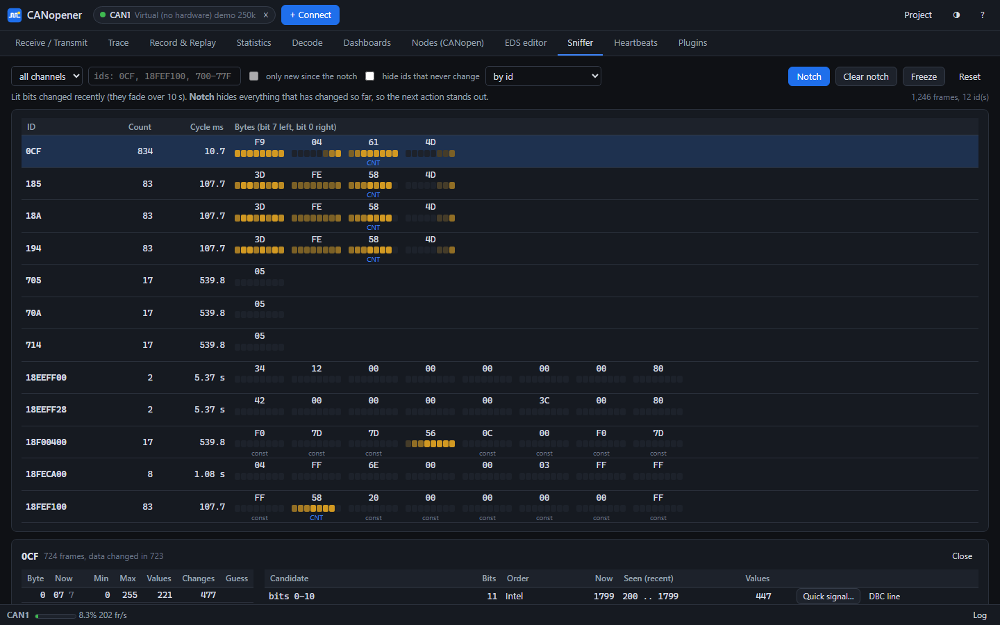

**The grid.** One row per id: the count, the cycle time and every byte, in hex and as its 8 bits (bit 7 left, bit
0 right). A bit lights up when it changes and fades over about 10 seconds, so counters flicker all the time,
constant bits stay dark and a signal lights up when it moves. Filter by channel and id (`0CF, 18FEF100, 700-77F`),
hide ids that never change, and sort by id, by the most recent change or by count. **Freeze** stops the view
(the analysis goes on); **Reset** forgets everything seen so far.

**Notch.** Let the sniffer watch the traffic for a few seconds first (a notch in the first seconds is refused,
because everything after it would look new). Press **Notch** to hide every bit that has changed so far (they are
shown hatched). Then do one thing on the machine: press a pedal, flip a switch, move a joystick. The bits that
change after the notch get a blue outline. **Only new since the notch** shows only the ids with such bits, plus
ids seen for the first time after the notch (marked **new id**; slow or event frames show up here too). **Clear
notch** shows everything again.

**Guesses per byte**, under each byte:

| Mark | Means |
|---|---|
| CNT | a counter: the byte changes in almost every frame, by the same step |
| CNT4 | a 4-bit counter in the low nibble (the high nibble does not move) |
| CHK | a checksum: the XOR, or the sum plus a constant, of the other bytes |
| const | never changed |

Bytes guessed as counters or checksums never count as new after a notch, because they change all the time
anyway; a wrong guess can therefore hide a real signal. Only XOR and sum checksums are recognised (not CRCs). The
guesses come from the frames seen so far and are updated every second, so give them a few seconds of traffic,
and check them.

**Details and candidates.** Click a row for its details: per byte the value now, the lowest and highest value
seen, how many different values and changes, and the guess. **Candidates** are the bit ranges that changed (after
the notch, if there is one; bytes guessed as counters or checksums left out): each run of changed bits in Intel
and in Motorola bit order, and each group of neighbouring changed bytes byte-aligned in both byte orders, at most
64 bits each. Each shows the raw value now and the lowest and highest value of its recent changes (the last
1000 frames of that id in which such bits changed).

- **Quick signal** makes it a quick signal (name, bits, byte order, signed, factor, offset, unit), so you can plot
  it on a dashboard right away.
- **DBC line** gives the `BO_`/`SG_` lines to paste into a DBC file (fix the name, scaling, unit and range).

Claude gets `get_sniffer_changes` (what changed, with guesses and candidates; read only) and `set_sniffer_notch`
(which only changes the sniffer's view, and is refused in the first seconds). So you can ask Claude to notch, do
the action, and then ask which bits moved.

The sniffer has been tried on the simulator and on made-up frames in the tests, not yet on a real machine.

## Dashboards

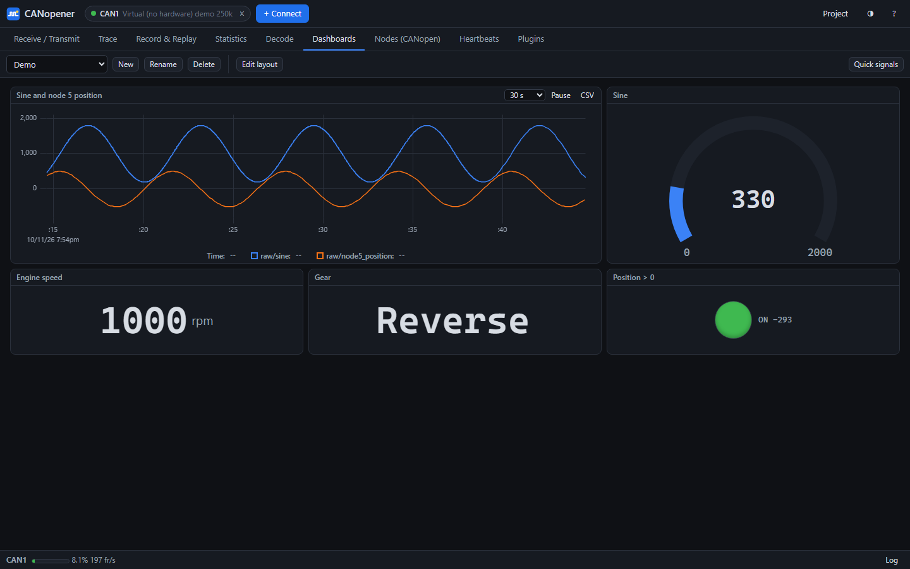

The **Dashboards** tab holds any number of named dashboards. Pick one in the list; **New**, **Rename** and
**Delete** manage them.

| Widget | Shows |
|---|---|
| Time plot | One or more signals over 10 s to 10 min. **Pause** freezes it; drag across the plot to zoom, double-click to zoom out; **CSV** saves the plotted values. |
| XY plot | One signal against another over a time window. |
| Gauge | A value on a dial with min, max, unit, number format and coloured threshold bands. |
| Numeric tile | A value with unit and format (auto, 0, 0.0, 0.00, 0.000, hex) and threshold colours. Named values show as text. |
| Bit lamp | On or off: when the value is not 0, when one bit is set, or when the value is at or above a threshold; with on and off colours. |

### Edit the layout

Click **Edit layout**. The button becomes **Done**, and **+ Widget** appears.

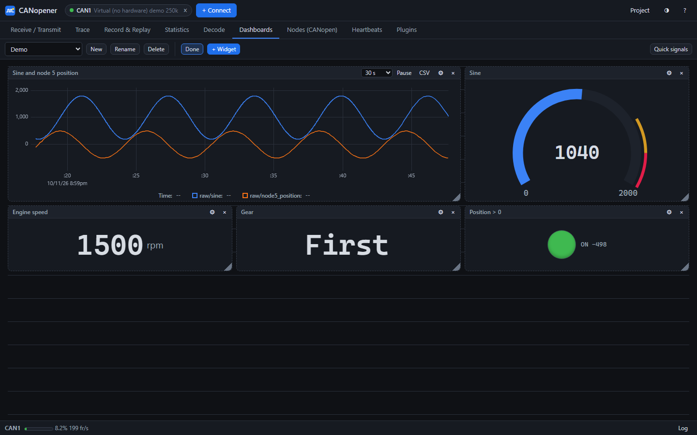

- **+ Widget** asks for the widget type, then its settings.
- Drag a widget by its title bar to move it; drag its bottom-right corner to resize. Widgets snap to a
  12-column grid and never overlap.
- **⚙** opens a widget's settings, **×** removes it.

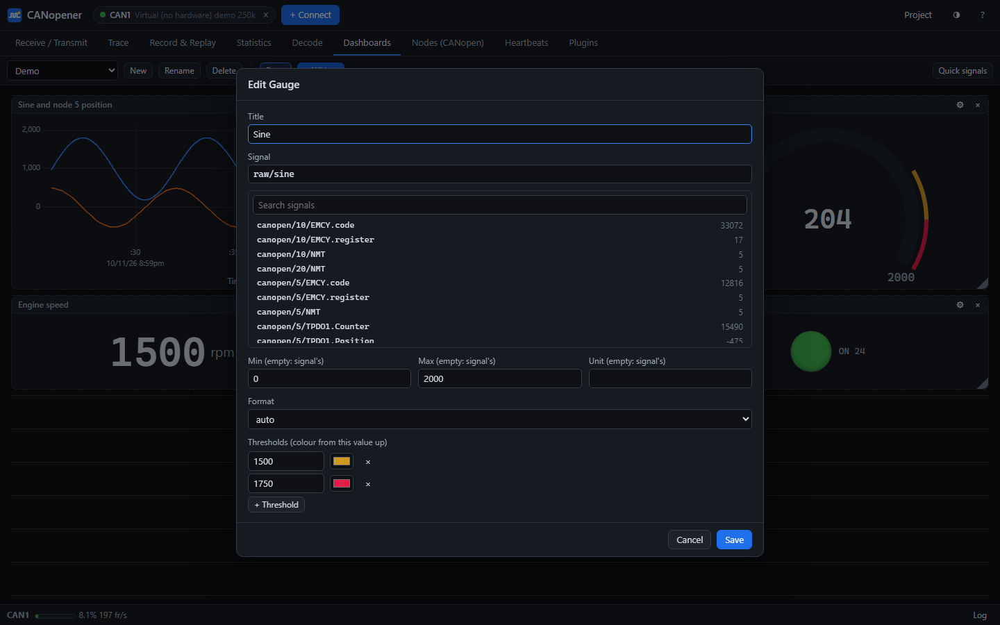

In the settings, **Search signals** lists every signal that is being published right now, with its current
value. Click one to use it (for a time plot: to add it). You can also type a key. Gauges and tiles take
min, max and unit from the signal when you leave them empty.

Changes are saved as you make them.

### Quick signals (without a DBC)

**Quick signals** defines signals on raw frames, for when there is no DBC file.

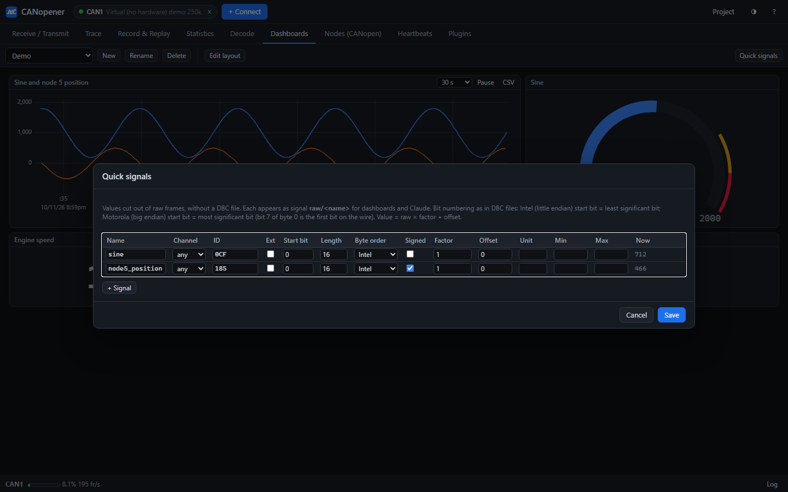

Per signal: **Name**, **Channel** (any or one), **ID** (hex; **Ext** for 29-bit, set automatically above
7FF), **Start bit**, **Length**, **Byte order** (Intel or Motorola), **Signed**, **Factor**, **Offset**,
**Unit**, **Min**, **Max**. The **Now** column shows the value decoded from the latest frame while you type.
**Save** publishes them as `raw/<name>`.

Bit numbering is as in DBC files: for Intel (little endian) the start bit is the least significant bit; for
Motorola (big endian) it is the most significant bit, and bit 7 of byte 0 is the first bit on the wire.
Value = raw × factor + offset.

Dashboards and quick signals are saved with the settings and in projects. Dashboards look the same in the light
theme:

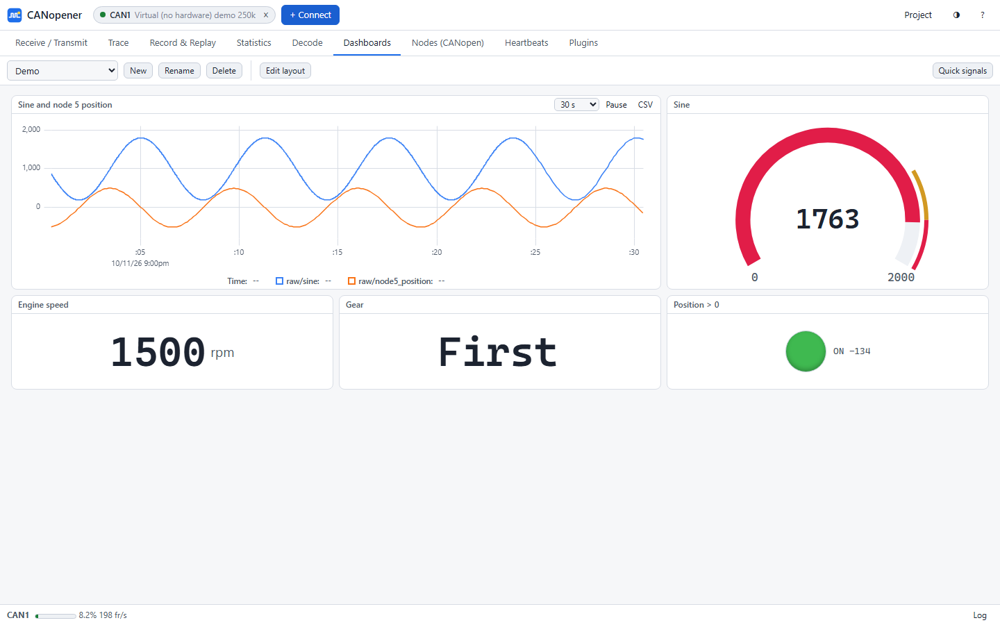

## Projects and settings

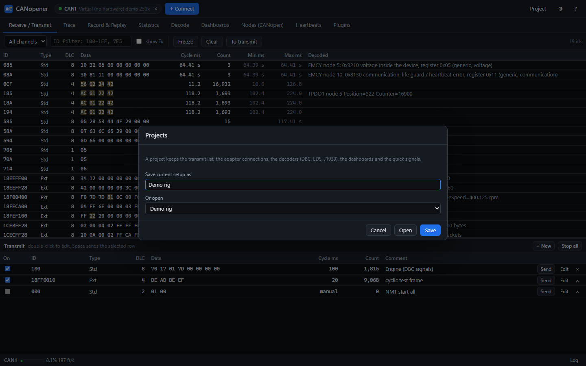

**Project** in the top bar saves or opens a whole setup under a name. A project keeps:

- the transmit list;
- the adapter settings of the connected channels;
- the decoder setup (DBC files, EDS per node, extra SDO servers, J1939 channels);
- the dashboards and quick signals.

**Save** stores the current setup under the name you type. **Open** loads a saved project: cyclic transmits
stop, the transmit list, decoders and dashboards are replaced, and if no adapter is connected CANopener asks
whether to connect the project's adapters.

Without projects, CANopener remembers anyway (in `settings.json`): the last connection of each channel (the
Connect dialog is filled in with it), the transmit list, the decoder setup, dashboards and quick signals.
Adapters are never connected automatically at start.

View preferences (theme, last tab, sort order, the receive / transmit split, the trace filter, the custom
sequence editor) are kept per PC in the window's own storage.

## Task walkthroughs

### Watch a bus and find which ID floods it

1. Connect the adapter with **Listen-only** ticked (see [Listen-only](#listen-only)).
2. Look at the status bar: bus load and frames per second. The load bar changes colour above 50 % and turns
   red above 80 %.
3. Open **Statistics**. **Busiest IDs** ranks the periodic IDs by frames per second; the top rows are what
   loads the bus. **Min - max ms** shows whether an ID is regular or bursty.
4. On **Receive / Transmit**, click the **Count** header (twice for highest first) or **Cycle ms**. Type the
   suspect ID into the **ID filter** to watch only it.
5. To see the order of frames around a burst, open **Trace**, type the busy IDs into **IDs** and tick
   **exclude** to hide them, or leave **exclude** off to see only them. **Delta (ms)** shows the gaps.

Error frames and bus state warnings show in the status bar and on the Statistics card. Many error frames with
little traffic often mean a wrong bit rate or missing termination.

### Send a cyclic frame

1. Connect (not listen-only).
2. Under **Transmit**, click **+ New**.
3. Type the **ID (hex)**, the **Data (hex bytes)** and a **Cycle time ms** (for example 100).
4. Click **Add**.
5. Tick **On** in the new row. **Count** starts counting.

Untick **On** to stop it; **Stop all** stops every cyclic entry. To send a frame once, set the cycle time to
0 and click **Send** (or select the row and press Space). To copy a frame you see on the bus, select it in the
receive list and click **To transmit**.

### Record a fault and send the file to a colleague

1. Connect the channels you need (listen-only is fine).
2. On **Record & Replay**, type a **File name**, for example `fault-hunt`, and choose the format your
   colleague uses: `.trc` (PCAN-View), `.blf` or `.asc` (Vector tools), `.log` (candump), `.csv` for a
   spreadsheet. Opening them in those programs has not been tried yet.
3. Click **Start recording** before the fault happens. The top bar shows **REC** with the frame count.
4. When the fault has happened, click **Stop**.
5. In **Recordings**, click **Download** on the file to save a copy where you want, or take it from the
   `recordings` folder next to `canopener.exe` and attach it to an e-mail.

Missed the start? **Trace** > **Save...** writes what the trace buffer still holds (about 260 000 frames per
channel; how long that covers depends on the bus load) to a file.

### Open a recording offline

1. If the file is not in the recordings folder yet, click **Import file...** in **Recordings** and pick it.
2. Click **Open** on the file. No adapter is needed.
3. The receive list shows the file's IDs with their recorded cycle times; choose the file channel in the
   channel selector to see only it. The trace shows the frames from the start.
4. Close the file with the **×** on its chip.

To play the file onto a real bus instead, use **Replay...**.

### Give a CANopen node a new ID

With the simulator you can try both ways safely: demo device A has an SDO recipe, the demo LSS device uses LSS.

**With an SDO recipe** (a device CANopener has a recipe for):

1. On **Nodes (CANopen)**, click **Scan**.
2. On the node's row (for example node 5, recipe `sim-demo-a`), click **Set ID...**.
3. Type the **New node ID** (for example 6) and click **Preview**.
4. Read the frames: the SDO write of the node-id object, the store to 0x1010:01, the NMT reset, and the check
   that node 6 answers.

   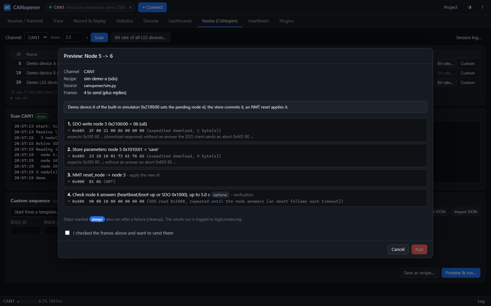
5. Tick **I checked the frames above and want to send them** and click **Run**.
6. The job log shows each step; the result says whether the node answered at its new id. **Scan** again to see
   it in the table.

If the device needs a power cycle (demo device B), the preview warns, and the result says "power cycle
required". Switch the device off and on, then scan. (In the simulator, demo device B applies its new id at
the next NMT reset instead: Decode > CANopen > **Reset** on node 10.)

**With LSS** (CiA 305):

1. Scan, then **Set ID...** on the node (for example node 20, recipe `generic-lss`).
2. The preview selects the device by its identity (switch selective: vendor, product, revision, serial), so
   only this device is configured even when several LSS devices share the bus (tested on the simulator, not yet
   on real devices). Then configure node id, store,
   switch every device back to waiting (an **always** step), NMT reset communication, and the check of the new
   id.
3. Tick the box and **Run**.

For a single LSS device whose identity you do not know (it may not even have a valid node id), use the custom
sequence template **LSS: give the only device on the bus a node id**. It uses switch global, so connect only
that one device.

### Change bit rates

The whole bus has to move together. Plan it so you do not lose contact with devices halfway:

1. Scan, so CANopener knows the devices and their recipes.
2. For every LSS device at once: **Bit rate of all LSS devices...**, choose the new rate, **Preview**, check,
   **Run**. The devices should store the new rate and switch after the switch delay; the adapter reopens at the
   new rate and waits for traffic. This has been tested on the simulator only.
3. For a device with an SDO bit-rate recipe (demo device A): **Bit rate...** on its row. A device that only
   switches after a power cycle (the preview says so) is reached again after you power it and reconnect at the
   new rate.
4. Afterwards, check the chip in the top bar shows the new rate, and **Scan** again.

Devices without LSS or a recipe stay at the old rate and are no longer heard; the preview warns about this.
Change those first (with their own tool or a custom sequence ending in a `reopen` step), and LSS devices last.

### Commission an unknown device and save a recipe

For a device CANopener has no recipe for. You need to know, from the device's manual or EDS, which object holds
its node id (and whether it needs a store and a reset).

1. **Scan**. The device shows with recipe `generic-lss`. If it does not support LSS, Set ID would fail.
2. Click **Custom** on its row: `$OLD_ID` and the identity variables are filled in.
3. **Start from a template...** > **SDO: write node id, store, reset**.
4. In the first step (`sdo_write`), set the **index**, **sub** and **type** of the device's node-id object.
   Leave the value as `$NEW_ID`.
5. Type the new id into `$NEW_ID`.
6. **Preview & run...**, check every frame, tick, **Run**. The result table shows each step's status.
7. When it worked, click **Save as recipe...**:
   - **Vendor id (hex)**: filled in from the scan;
   - **Name**: a short name;
   - **Used for**: changing the node ID (or the bit rate);
   - **New id takes effect**: immediately / after the reset in the steps, or after a power cycle;
   - **Note**: where the mechanism comes from (manual section, EDS, a trace).

   Keep `$OLD_ID`, `$NEW_ID` and `$BAUD` in the steps: the recipe fills them in each time.
8. From now on, **Set ID...** (and **Bit rate...**, for a bit-rate recipe) picks your recipe for every device
   with that vendor id. It is stored in `recipes\user-recipes.json`.

**Export JSON** saves the sequence to share it; a colleague loads it with **Import JSON** and saves it as a
recipe on their PC.

### Decode with a DBC and transmit by signal value

1. On **Decode** > **DBC**, give the path of the `.dbc` file and click **Load** (or **Upload...**).
2. Click a message in the **Messages** table for its signals, live. The receive list's **Decoded** column
   shows the decoded messages (tick **show Tx** to see your own frames decoded too).
3. To send by signal value: **+ New** under Transmit. In **Data from**, choose **DBC message ...**.
4. Type the signal values (lists for named values). The ID comes from the DBC; the bytes are encoded when
   you click **Add** and show in the transmit row.
5. Set a cycle time if wanted, **Add**, and tick **On**.

To change a value while it is sending, click **Edit**, change the signal, **Save**.

### CANopen EDS: PDOs, SDO browser, NMT, EMCY

1. On **Decode** > **CANopen**, type the **Node** id, give the path of the device's `.eds` (or `.dcf`, `.xdd`)
   and click **Assign**.
2. The node's PDOs decode from the file: values appear in the receive list's Decoded column (for example
   `TPDO1 node 5 Position=485 Counter=2290`) and as `canopen/<node>/...` signals for dashboards.
3. If the device's mapping differs from the file's defaults, click **Read PDO mapping**: the real mapping is read
   over SDO and used instead.
4. Click the node: its panel shows the PDO objects live and the SDO traffic. Open **Object dictionary** there:
   **Read** shows the value in the device. **Write...** asks for a value, then shows the SDO frames to confirm.
5. **Start**, **Stop**, **Pre-op**, **Reset**: NMT commands for the node, after the preview.
6. Emergencies of known nodes appear in the **EMCY log**, decoded.

### J1939: ECUs, DM1, transport messages

1. Connect at the bus rate (often 250 or 500 kbit/s), listen-only on a running vehicle.
2. On **Decode** > **J1939**, tick the channel.
3. **ECUs** fills as ECUs claim addresses. Address claims are sent at power-up and on request, so switch the
   ignition on after connecting, or wait.
4. **DM1** shows the active trouble codes and lamps of every ECU that sends them, single-frame and multi-packet
   (BAM) alike.
5. **Transport protocol messages** shows every reassembled long message.
6. Load a J1939 DBC on the DBC view to decode signals by PGN for every source address.

### Make an EDS for a device that came without one

1. Connect, then **Nodes > Scan** to see the node id.
2. **EDS editor > Create from node**: the channel, the node id, and leave the ranges empty for the full scan.
3. Go through the warnings under **Problems**: fix the guessed data types and access types with the manual, and
   give the manufacturer objects names.
4. **File and device info**: vendor name, product name.
5. **Save**, then **To decoder** to decode the node with it.

### Configure a node from a DCF

1. Open the device's EDS, then switch the format to **DCF**.
2. Type the values the node needs into **DCF value** (or set up one node by hand, then **Compare with node** and
   **Node values into DCF values**).
3. **Save as** `node12.dcf`, the record of that node's setup.
4. **To Nodes**: the node id; keep pre-operational and store ticked.
5. In the Nodes tab, check the steps, **Preview & run**, read the frames and run them.
6. **Compare with node** again: the values you wrote should be "same" (status words, actual values and the
   serial number differ by nature).
7. Start the node (NMT start), for example from the Nodes tab custom mode (template "NMT: start all nodes").

### Find which bits a pedal changes

This is how the sniffer is meant to be used; it has not been tried on a real machine yet.

1. Connect to the machine (listen-only is enough) and open **Sniffer**. Wait a few seconds, so counters and XOR or
   sum checksums get their marks.
2. Leave the pedal alone and press **Notch**.
3. Press the pedal slowly, all the way, and let it go.
4. Tick **only new since the notch**. Look for ids with blue-outlined bits: those followed the pedal (ids marked
   **new id** only appeared after the notch).
5. Click the id. Under **Candidates**, the range that covers the outlined bits should show a value that follows
   the pedal, and a seen range from released to fully pressed; try the Motorola and byte-aligned variants if the
   numbers jump.
6. **Quick signal**, give it a name, then plot `raw/<name>` on a dashboard and press the pedal again to check it.

### Build a dashboard

1. **Dashboards** > **New**, type a name. The new dashboard opens in edit mode.
2. **+ Widget** > for example **Time plot**. Click signals in the picker to add them, choose the time window,
   **Add**.
3. Add a **Gauge** or **Numeric tile** for a single value, a **Bit lamp** for a status bit.
4. Move and resize the widgets, then click **Done**.

No DBC for the frame you want to watch? Use **Quick signals**:

1. Click **Quick signals**, **+ Signal**.
2. Name it, type the **ID**, the **Start bit** and **Length**, byte order and sign, and factor / offset if
   needed. Watch the **Now** column: it decodes the latest frame as you type, so you can find the right bits
   by trial.
3. **Save**. The signal appears as `raw/<name>` in the widget picker.

### Save and reuse a setup with projects

1. Connect the adapters, fill the transmit list, load the decoders, build the dashboards.
2. **Project** > type a name > **Save**.
3. Later, or on another day: **Project** > pick it in **Or open** > **Open**. CANopener offers to connect the
   project's adapters.

Project files are in the `projects` folder; copy one to a colleague's `projects` folder to share the setup.

## Claude (MCP)

While CANopener runs, it serves an MCP endpoint at `http://127.0.0.1:8775/mcp/` (the address is also shown in
the About box). Add it to Claude Code once:

```
claude mcp add --transport http canopener http://127.0.0.1:8775/mcp/
```

Claude then works on the same bus session as your window: it sees what you see, and you see what it does.
Channels are numbered from 0 for Claude (channel 0 is CAN1 in the window).

**What Claude can do without asking.** The read tools only read. Their names start with `get_`, `list_`,
`read_` or `scan_`, so you can allowlist them in Claude Code:

- `get_about`, `get_status`, `list_devices`, `get_bus_stats`;
- `get_receive_table`, `get_trace`, `get_signals`, `get_signal_history`, `get_decoded_frames`;
- `list_recordings`, `read_recording`;
- `scan_nodes`, `get_node_scan`, `get_node_job`, `list_recipes`;
- the previews: `get_set_node_id_preview`, `get_baud_preview`, `get_sequence_preview`,
  `get_sdo_write_preview`, `get_nmt_preview` (they return frames, they send nothing);
- `get_decode_config`, `list_dbc_messages`, `get_canopen_state`, `list_object_dictionary`, `read_sdo`,
  `get_j1939_state`, and the detail views: `get_pdo_values`, `get_sdo_log` (SDO traffic of a node, from any
  master), `get_dbc_message_values`, `get_j1939_source`;
- `list_dashboards`, `get_dashboard`;
- plugin read tools: `get_heartbeat_nodes` (heartbeat monitor), `get_eds_problems`, `list_eds_objects`,
  `get_eds_pdos` (the PDOs of a file, decoded) and `read_node_vs_eds` (EDS editor), `get_sniffer_changes`
  (sniffer).

`scan_nodes`, `read_sdo` and `read_node_vs_eds` do send frames (SDO reads, and a listen period), but they change
nothing on a node.

**What stays on approval.** Every other tool has another verb and transmits, records, replays, loads files or
changes a node: `connect_channel`, `disconnect_channel`, `send_frame`, `add_transmit_entry`,
`set_transmit_entry`, `stop_all_transmit`, `start_recording`, `stop_recording`, `start_replay`, `stop_replay`,
`open_recording_view`, `load_dbc_file`, `assign_eds_file`, `add_sdo_server`, `remove_sdo_server`,
`set_j1939_decoding`, `load_pdo_mapping_from_device`,
`save_dashboard`, `delete_dashboard`, `save_user_recipe`, `create_eds_from_node` (probes a node and saves an
EDS), `set_sniffer_notch` (changes only the sniffer's view) and `run_node_plan`. Keep these on approval, so Claude
Code asks you for each call.

**Node changes take two steps.** Claude first calls a preview tool (`get_set_node_id_preview`,
`get_baud_preview`, `get_sequence_preview`, `get_sdo_write_preview` or `get_nmt_preview`). It returns the exact
frames and a token, and Claude shows you the frames. Then it calls `run_node_plan(token, title)`, which runs
that plan unchanged. The title must be the preview's title, for example `Node 5 -> 6`, so the approval prompt
says what will run. The run is logged in `logs\nodes.log` as done by Claude.

Things to ask, for example:

- "What is on the bus? Which IDs are busiest?"
- "Scan for CANopen nodes and tell me what you find."
- "Show me the frames to change node 5 to node 6." (and, after reading them, "Run it.")
- "Decode the last DM1 of every ECU."
- "Open fault-hunt.trc and find when 0x185 stopped."

## Plugins

A plugin is a folder with a `manifest.json` and a Python module. It can add:

- tabs to the window;
- REST routes;
- MCP tools for Claude;
- live frame consumers; the receive threads never wait for them.

To install one, put its folder into the `plugins` folder next to `canopener.exe` and restart CANopener. The
**Plugins** tab lists what loaded, from which folder, and what failed (with the error). A broken plugin never
stops CANopener.

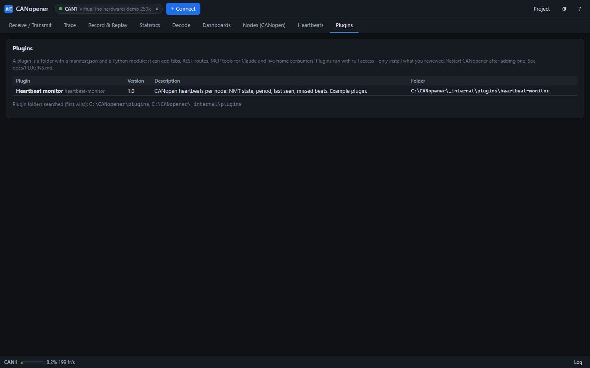

Three plugins ship with CANopener:

- the [EDS editor](#eds-editor);
- the [Sniffer](#sniffer);
- a CANopen heartbeat monitor, a small example to start from: the **Heartbeats** tab shows, per node, the NMT
  state, the heartbeat period, when it was last seen, the count and the boot-ups, and Claude gets
  `get_heartbeat_nodes`. A node is marked **lost** when no heartbeat came for 3 periods. Boot-ups are counted
  but are not heartbeats: a node that only sends boot-ups is marked **boot-up only / no heartbeat** and has no
  period.

Plugins run with full access to your PC and the bus: install only what you have reviewed. To write one, see
[Writing plugins](PLUGINS.md).

## Command line

`canopener-cli.exe` (next to `canopener.exe`) runs the same program with a console. `canopener-cli.exe --help`
lists the commands, `canopener-cli.exe <command> --help` the options.

| Command | Does |
|---|---|
| `app` | The app window (the default when started without a command). `--port`. |
| `serve` | The server only; open `http://127.0.0.1:8775/` in a browser. `--port`, `--host`. Ctrl+C stops it. |
| `devices` | Lists the adapters that are plugged in. `--json`. |
| `scan` | Scans a CANopen bus and lists the nodes. `--seconds`, `--sdo-timeout`, `--json`. |
| `set` | Changes a node's node id: `--from`, `--to`, `--method` (lss, readonly, sdo:&lt;name&gt;), `--verify-timeout`, `--recipes`. |
| `baud` | Changes the bit rate: `--to` (kbit/s), `--node` (one node) or `--global` (every LSS device, the default), `--switch-delay-ms`. |
| `record` | Captures for `--seconds` to `--out`; the extension picks the format. `--listen-only`. |
| `trace` | Captures to `.trc` (or `.canbin` with `--canbin`); `trace convert in.canbin out.trc`. |
| `replay` | Plays a recorded file onto the bus: `--speed`, `--only` (all, rx, tx). |
| `convert` | Converts between recording formats, by extension. |

The bus commands take `--interface` (pcan, kvaser, slcan, gs_usb, vector, ixxat, gvret, obdlink, socketcan,
virtual; default
virtual), `--channel`, `--bitrate` (bit/s, default 250000), `--fd`, `--data-bitrate`, and `-v` to print every
step and frame. The command line does not start the simulator: without `--interface`, a `scan` finds an empty
virtual bus.

```
canopener-cli.exe devices
canopener-cli.exe scan    --interface kvaser --channel 0 --bitrate 250000
canopener-cli.exe set     --interface pcan --from 1 --to 72
canopener-cli.exe baud    --interface pcan --to 500 --node 72
canopener-cli.exe record  --interface pcan --seconds 60 --out capture.blf --listen-only
canopener-cli.exe replay  --interface pcan capture.blf --speed 1
canopener-cli.exe convert capture.canbin capture.trc
canopener-cli.exe serve   --port 8775
```

`set` (and `baud --node`) scan first. `set` and `baud` print the same exact-frame plan as the window and ask `Send this? [y/N]` before
sending anything. `--yes` skips the question (for scripts).

`serve --host 0.0.0.0` makes CANopener reachable from other PCs. There is no login: anyone who can reach the
port can use the bus. Only do this on a network you trust.

## Files and folders

Everything sits next to `canopener.exe` (from source: in the repository folder):

| Folder / file | Contents |
|---|---|
| `recordings\` | Recordings, trace saves and imported files. |
| `logs\canopener.log` | The app log. |
| `logs\nodes.log` | Node scans from the window, and every plan and run, with the frames. |
| `projects\` | Saved projects (one `.json` each). |
| `settings.json` | Last connections, transmit list, decoder setup, dashboards, quick signals. |
| `recipes\user-recipes.json` | Recipes saved from the custom mode. |
| `eds\` | Files saved by the EDS editor. |
| `decode\` | DBC and EDS files uploaded in Decode. |
| `plugins\` | Your plugins. |
| `docs\user-guide.html` | This guide (open it by double-click; the About box opens it too). |
| `README.txt` | A one-page summary. |

To move CANopener to another PC, copy the whole folder. To start fresh, delete `settings.json`.

Environment variables for special setups: `CANOPENER_HOME` puts the app folder elsewhere,
`CANOPENER_PLUGIN_DIRS` adds plugin folders (separated by `;`), `CANOPENER_USER_RECIPES` points to another user
recipes file.

## Troubleshooting

**Nothing happens on double-click.** Run `canopener-cli.exe app` in a command prompt to see the message, and
read `logs\canopener.log`.

**"Port 8775 is in use by another program".** Another program uses CANopener's port. Close it, or start
CANopener on another port: `canopener-cli.exe app --port 8776` (the MCP address then changes too).

**Windows protected your PC.** See [Download and start](#download-and-start): **More info**, **Run anyway**.

**An adapter is not detected.**

- Install the adapter's driver (PEAK, Kvaser, Vector, IXXAT). Unplug and replug, then **Refresh**.
- CANable with candleLight firmware: it may need the WinUSB driver bound to it once, for example with Zadig
  (not yet confirmed).
- CANable with slcan firmware: it is a COM port; check Device Manager for its number and type it as the channel.
- Close other programs that hold the adapter (another CAN tool, a second CANopener on another port).

**"... cannot run at ... bit/s".** That adapter's driver has no setting for that rate. The message lists the
rates it can do.

**"... cannot be opened listen-only" / "does not support CAN FD".** That interface has no listen-only mode or no
CAN FD in CANopener (see the adapter table).

**No frames at all.**

- Check the bit rate: a wrong rate shows as error frames or nothing.
- Check the wiring (CAN high, CAN low, ground) and the termination: 120 Ω at both ends of the bus, about 60 Ω
  measured between CAN high and CAN low with the power off.
- Something must acknowledge frames. A lone adapter that transmits, with no other node on the bus, sees its
  frames fail.

**Error frames, bus state "passive" or "bus off".** Usually a wrong bit rate, missing termination, or a bad
connection.

**The trace says frames were "not shown live".** More than 25 000 frames per second arrived. They are all in
the buffer, in **Save...** and in any recording; only the live view skipped them.

**A scan finds no node.** Check the bit rate. The table note says whether there was other traffic. Devices that
are in LSS configuration state or have no valid node id (255) do not answer SDO: use LSS.

**A Set ID run failed.** Read the job log and the result table: which step failed and what the device answered
(an SDO abort code, a timeout). Steps marked **always** have already put LSS devices back to waiting. The run is
in `logs\nodes.log`.

**The Decoded column stays empty.** Load a DBC or assign an EDS on the Decode tab, and switch J1939 on for
J1939 channels. Your own frames are decoded too, but only show with **show Tx**.

**A plugin does not load.** The **Plugins** tab shows the error. Check `manifest.json` and restart CANopener
after every change.

**Claude does not see CANopener.** CANopener must be running. Check the address in the About box (another port
means another MCP address) and run `claude mcp list`.

## FAQ

**Does CANopener replace PCAN-View?** That is the goal: receive list, transmit list, trace, recording in the
`.trc` format, statistics, with PEAK and many other adapters. So far only a Kvaser has been tested on a real
bus, receiving and sending by replay; the transmit list and other adapters are not yet confirmed (see
[Adapters](#adapters)).

**Can it damage a device?** Watching with an adapter in listen-only mode should not disturb the bus (not yet
confirmed on hardware). Without listen-only, the adapter acknowledges frames like any node. Sending can, like any
CAN tool:
transmits and replays go onto the bus as you set them up. Node changes are always shown as exact frames first
and need your confirmation.

**Can I use two CANopener windows?** Yes. Both show the same session. A second CANopener with its own adapters
needs another port: `canopener-cli.exe app --port 8776`.

**Does it run on Linux?** It should from source, with SocketCAN, slcan, candleLight and the other python-can
backends, but that has not been tried yet. The release download is for Windows.

**Where are my recordings?** In the `recordings` folder next to `canopener.exe`; the Record & Replay tab shows
the path.

**Why does my vendor's device show "generic-lss"?** CANopener ships no recipes for real devices. LSS is the
standard way; if the device uses its own object instead, build the sequence once in the custom mode and save it
as a recipe.

**Is my data sent anywhere?** No. CANopener runs locally and makes no connections to the internet. The MCP
endpoint is only reachable from your own PC (unless you start `serve --host`).
