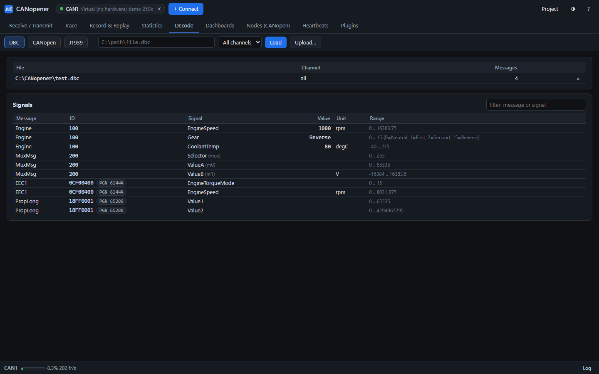

# CANopener user guide

CANopener is an open-source CAN engineering toolbox for Windows (and, from source, Linux). It covers what
PCAN-View does (receive list, trace, transmit list, record and replay, bus statistics) for many adapters. It
adds CANopen node commissioning, a plugin system and an MCP endpoint, so Claude can read the bus and, with your
approval, act on it.

## Contents

1. [Start](#start)
2. [Connect an adapter](#connect-an-adapter)
3. [Receive / Transmit](#receive--transmit)
4. [Trace](#trace)
5. [Record & Replay](#record--replay)
6. [Statistics](#statistics)
7. [Nodes (CANopen)](#nodes-canopen)
8. [Decode (DBC, CANopen, J1939)](#decode-dbc-canopen-j1939)
9. [Dashboards](#dashboards)
10. [Projects and settings](#projects-and-settings)
11. [Plugins](#plugins)
12. [Claude (MCP)](#claude-mcp)
13. [Command line](#command-line)
14. [Files and folders](#files-and-folders)
15. [Troubleshooting](#troubleshooting)

## Start

1. Unzip the release somewhere you can write to.
2. Double-click `canopener.exe`. The app opens in its own window.
   - Windows SmartScreen may warn you the first time, because the exe is not signed. Click **More info**, then
     **Run anyway**.
3. A second double-click opens another window onto the same running CANopener. There is only ever one server
   per PC and port.

Closing the window first stops cyclic transmits and a running replay. Then it finishes any recording and closes
the adapters.

## Connect an adapter

Click **+ Connect** (or press Ctrl+K).


- **Detected adapters** lists what is plugged in right now. Pick an entry to fill in the interface and channel.
- **Interface / Channel**: choose them by hand if your adapter is not detected. Typical channels are
  `PCAN_USBBUS1`, `0` for Kvaser, and `COM5` for slcan.
- **Bit rate**: nominal bit rate. A rate the adapter's driver cannot do is refused with a message, never
  silently replaced.
- **CAN FD** and **FD data bit rate**: for backends that support FD. For slcan (CANable 2) the data rate must
  be 2 or 5 Mbit/s.
- **Listen-only**: the adapter never ACKs or transmits. Use it on a live machine when you only want to watch.
  Sending, scans and node changes are refused on a listen-only channel.
- **Start simulated devices** (Virtual interface only): simulated CANopen nodes plus PDO and J1939 traffic, to
  try everything without hardware.

You can connect several channels (CAN1, CAN2, …). Each shows as a chip in the top bar; its × disconnects it.
The status bar shows each channel's bus load, frames per second and error counters.

| Adapter | Notes |
|---|---|
| PEAK PCAN-USB | Needs the PEAK driver (PCAN-View installs it). Listen-only and CAN FD supported. |
| Kvaser | Needs the Kvaser driver. Listen-only (silent mode) and CAN FD supported. "Kvaser Virtual CAN Driver" channels are a built-in loopback pair. |
| CANable (slcan firmware) | A COM port, no driver needed. CAN FD at a 2 or 5 Mbit/s data rate. Clones that keep ST's USB id show as "STM32 virtual COM port". |
| CANable (candleLight firmware) | A USB device. libusb is included. If it is not detected, bind WinUSB once with Zadig. Classic CAN only. |
| Vector | Needs the Vector driver library. The channel is the driver's global channel index. |
| IXXAT | Needs the IXXAT VCI driver. |
| SocketCAN | Linux. Set the bit rate with `ip link`. |
| Virtual | In-process bus for trying things and for tests. |

## Receive / Transmit


**Receive list (top).** One row per CAN ID (per channel):

- type (Std, Ext, FD, RTR), DLC and the last data;
- the last cycle time, the min/max cycle time and the count.

Bytes that changed in the last 1.5 s are highlighted.

- Click a column header to sort.
- The **ID filter** takes hex IDs and ranges: `100-1FF, 7E5`.
- **show Tx** adds rows for frames CANopener itself sent.
- **Freeze** stops the view from updating. Traffic keeps counting.
- **Clear** resets the list and counters of the selected channel (or all).
- **To transmit**, or a double-click on a row, copies a received frame into the transmit list.

**Transmit list (bottom).**

- **+ New** adds an entry: ID (hex), channel, extended / FD / BRS / remote flags, data, cycle time and comment.
  A cycle time of 0 means manual.
- **Send** sends the entry once. Select a row and press Space to send it.
- The **On** checkbox starts or stops a cyclic entry. **Stop all** stops every cyclic entry.
- Double-click a row to edit it.
- The transmit list is saved automatically. Cyclic entries never start by themselves after a restart.

## Trace

Every frame in time order, Rx and Tx, from all channels.


- **Pause** stops the live view. Recording and counters keep running.
- **Filter**: by channel, ID list or ranges (or **exclude** them), direction, or data containing a hex string.
  The filter runs in the server, so a rare ID is never lost among thousands of others.
- **Time** shows seconds since the first frame, the delta to the previous frame, or wall-clock time.
- **Save…** writes everything the trace buffer holds (all channels, unfiltered, about the last 260 000 frames
  per channel) to a file in the recordings folder. Use **Record** for long captures.

The live view shows up to 25 000 frames/s. If more arrive, the info line says how many were not shown live.
They are still in the buffer and in any recording.

## Record & Replay


**Record.** Choose a format and click **Start recording**. Every connected channel is recorded, Rx and Tx, by
its own writer thread, so a busy bus does not drop frames. An existing file is never overwritten; `-1`, `-2` is
added instead.

| Format | Use |
|---|---|
| `.trc` | PCAN-View (v2.1: CAN FD, Rx/Tx, several buses). |
| `.blf` / `.asc` | Vector (CANalyzer, CANoe, …). |
| `.log` | Linux candump. |
| `.csv` | Spreadsheets. |
| `.canbin` | A compact binary format for PLC-side loggers (classic CAN). |

**Recordings** lists the files in the recordings folder:

- **Open** loads a file as an offline "file channel". The receive list shows its IDs with their real cycle
  times, and the trace shows its frames.
- **Replay…** sends the file onto a bus with the recorded timing: speed 0.5x to 10x, loop, and recorded Rx only
  or Tx only.
- **Download** saves a copy.
- **Import file…** copies a file into the recordings folder.

## Statistics


Per channel:

- state and bus state;
- bus load (estimated from the frames, plus the adapter's own figure for Kvaser), current and peak;
- frames per second;
- received and transmitted frames;
- error frames, receive and send errors, adapter overruns;
- distinct IDs.

A 10-minute history chart shows load and frame rate. **Busiest IDs** ranks periodic IDs by their average rate.

## Nodes (CANopen)


**Scan** listens for the set time (heartbeats, boot-ups, PDOs), then pings every node id with an SDO read of
0x1000. For each node found it reads identity (0x1018) and name (0x1008). The table shows each node with the
**recipe** CANopener will use to change its node ID and bit rate. Recipes are picked by vendor id (and product
code, when a recipe names one); LSS (CiA 305) is the default. CANopener ships no vendor recipes, only those of
the simulator's demo devices: build your device's sequence in the custom mode below and **Save as recipe**.

On a listen-only channel the scan only listens.

**Set ID…** asks for the new id. You then see the preview:

- the recipe and its source;
- the conflict check: the new id's COB-IDs against every raw ID seen on the bus, not only other CANopen nodes;
- warnings, for example that a power cycle is needed;
- every step with the **exact frames** that will be sent, including conditional ones (an SDO abort after a
  timeout, polls of the new id).


Nothing is sent until you tick **I checked the frames above** and click **Run**. The run shows live in the job
log and is appended to `logs\nodes.log`.

**Bit rate…** works the same way: the node's SDO recipe, or LSS for one node or for every LSS device. The
sequence is configure, store, then activate. After the switch the adapter reopens at the new rate and waits for
traffic.

### Custom mode for unknown devices

The **Custom sequence** editor builds your own steps. Templates give a starting point (SDO node id + store +
reset, LSS node id for a single device, LSS bit rate, read identity, NMT).

| Step | What it sends |
|---|---|
| `sdo_write` / `sdo_read` | SDO download / upload. Types u8…i64, f32, str, bytes. A read can require an expected value. |
| `store` | 0x1010 'save'. |
| `nmt` | start, stop, preop, reset_node, reset_comm, to one node or all (0). |
| `raw` | Any frame (11/29-bit, FD). |
| `lss` | switch_global, switch_selective, configure_node_id, configure_bit_timing, activate_bit_timing, store, inquire_node_id. |
| `delay` | A pause in ms. |
| `reopen` | Reopen the adapter at another bit rate. |
| `wait_node` / `wait_traffic` | Checks: the node answers, or any frame arrives. |

- **Placeholders** fill in values: `$OLD_ID`, `$NEW_ID`, `$BAUD` (kbit/s), `$VENDOR`, `$PRODUCT`, `$REVISION`,
  `$SERIAL`, and your own variables. **Custom** on a scanned node fills in its id and identity.
- **always**: the step also runs after a failure. Use it for cleanup, for example LSS back to waiting.
- **optional**: a failure is only a warning.

**Preview & run** shows the same exact-frame preview. When a sequence works, **Save as recipe…** stores it for
that vendor id in `recipes\user-recipes.json`. From then on, Set ID or Bit rate picks it automatically for that
vendor. **Export / Import JSON** shares sequences.

## Decode (DBC, CANopen, J1939)



Decoded values appear in the receive list's **Decoded** column, on the **Decode** tab, in dashboards and for
Claude.

- **DBC**: load one or more `.dbc` files by path or upload, for all channels or one. Messages decode with units
  and enum names, multiplexed messages included. J1939 DBC messages match by PGN on channels with J1939 on, so
  every source address decodes. The transmit dialog has a **DBC message** mode: pick a message, type signal
  values, and CANopener encodes the bytes (single or cyclic).
- **CANopen**: assign an `.eds`, `.dcf` or `.xdd` to a node id. TPDOs/RPDOs decode from the file's mapping, or
  **Read PDO mapping** reads the real mapping from the device over SDO. The object dictionary browser reads objects;
  **Write** and the NMT buttons (start, stop, pre-operational, reset) open the same exact-frame preview as the
  Nodes tab. Emergency messages (EMCY) are decoded into a log (error code class, error register bits, vendor
  bytes); heartbeats give each node's NMT state.
- **J1939**: switch it on per channel. 29-bit ids split into priority, PGN, source and destination; address
  claims fill an ECU list with the NAME decoded; transport protocol messages (RTS/CTS and BAM) are reassembled and
  decoded; DM1 shows lamps and active DTCs (SPN, FMI, occurrence count).

Signal names are `dbc/<Message>/<Signal>`, `canopen/<node>/<PDO>.<variable>` and `j1939/<SA>/<PGN>.<Signal>`.
The decoder setup is saved with the settings and in projects.

## Dashboards


The **Dashboards** tab holds any number of named dashboards. Click **Edit layout** to add, move, resize and configure
widgets on the grid (**Edit layout**):

| Widget | Shows |
|---|---|
| Time plot | One or more signals over 10 s to 10 min; pause, drag to zoom, export CSV. |
| XY plot | One signal against another. |
| Gauge | A value on a dial with min/max and coloured threshold bands. |
| Number | A value with unit and format. |
| Lamp | On/off from a bool, one bit of a value, or a threshold. |

Any decoded signal can be plotted. Without a DBC, define **Quick signals** on raw frames (id, start bit, length,
byte order, signed, factor/offset, unit) with a live preview; they publish as `raw/<name>`. Dashboards and quick
signals are saved with the settings and in projects.

## Projects and settings

The top-bar **Project** button saves the transmit list, the adapter settings and the view under a name, or opens
one.

Without projects, the last connections and the transmit list are remembered anyway in `settings.json`. View
preferences (theme, tab, column sort) are kept per PC.

## Plugins

A plugin can add:

- tabs;
- REST routes;
- MCP tools;
- live frame consumers that never slow the receive threads down.

Put plugin folders in `plugins\` next to the exe and restart. The **Plugins** tab lists what loaded and what
failed. The shipped example is a CANopen heartbeat monitor (the **Heartbeats** tab). To write your own, see
[PLUGINS.md](PLUGINS.md). Plugins run with full access: install only what you reviewed.

## Claude (MCP)

While CANopener runs, it serves MCP at `http://127.0.0.1:8775/mcp/`:

```
claude mcp add --transport http canopener http://127.0.0.1:8775/mcp/
```

- **Read tools**: status, devices, statistics, receive table, trace, decoded signals, recordings, scans and
  previews. Their names start with get_, list_, read_ or scan_, so you can allowlist them in Claude Code.
  scan_nodes does send frames (SDO reads of 0x1000/0x1018/0x1008); it changes nothing on a node.
- **Everything that transmits your frames, records, replays or changes a node** has another verb. Keep those on
  approval, so you see each call.
- **Node changes** are always `get_..._preview`, which returns the exact frames and a token, then
  `run_node_plan(token, title)`.

## Command line

`canopener-cli.exe` runs the same program with a console:

```
canopener-cli.exe devices
canopener-cli.exe scan   --interface kvaser --channel 0 --bitrate 250000
canopener-cli.exe set    --interface pcan --from 1 --to 72
canopener-cli.exe baud   --interface pcan --to 500 --node 72
canopener-cli.exe record --interface pcan --seconds 60 --out capture.blf
canopener-cli.exe replay --interface pcan capture.blf --speed 1
canopener-cli.exe convert capture.canbin capture.trc
canopener-cli.exe serve  --port 8775
```

`set` and `baud` print the same exact-frame preview and ask before sending. `--yes` skips the question.

## Files and folders

Everything sits next to `canopener.exe`:

| Folder / file | Contents |
|---|---|
| `recordings\` | Recordings and trace saves. |
| `logs\canopener.log` | App log. |
| `logs\nodes.log` | Every node scan, plan and run. |
| `projects\` | Saved projects. |
| `settings.json` | Last connections, transmit list, settings. |
| `recipes\user-recipes.json` | Recipes saved from the custom mode. |
| `plugins\` | Your plugins. |

## Troubleshooting

- **Nothing happens on double-click.** Run `canopener-cli.exe app` in a command prompt to see the message, and
  read `logs\canopener.log`.
- **"Port 8775 is in use by another program".** Close it, or run `canopener-cli.exe app --port 8776`.
- **An adapter is not detected.** Install its vendor driver. For a CANable with candleLight firmware, bind WinUSB
  with Zadig.
- **"cannot run at … bit/s".** That adapter's driver has no setting for the rate; pick one from the list in the
  message.
- **No frames at all.** Check the bit rate, termination (120 Ω at both ends), and that something on the bus ACKs.
  A lone transmitter with no other node sees its frames fail.
